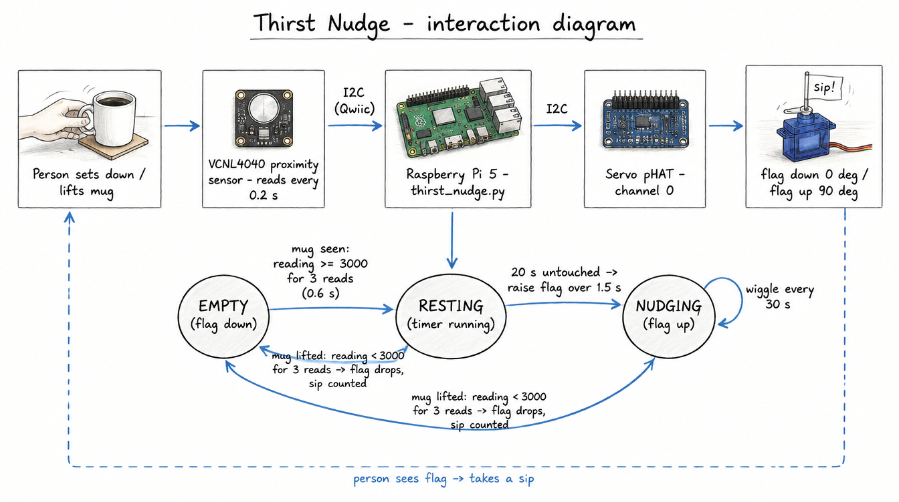

# Ph-UI!!!

**Author:** Pablo Penalba.

For Part 1, I tested each sensor and the servo from the kit one at a time, then designed a Feast Automata concept: the **Thirst Nudge**, a coaster that raises a little "sip!" flag when a drink has sat untouched for too long.

**Design and engineering:** I chose the concepts, sensor placements and final design, did all the physical handling in each hardware test, and built the cardboard prototype. **AI assistance:** Under my direction, Claude helped with Pi setup, ran the test scripts over SSH while I handled the hardware, analyzed the logs, made the two small test-script fixes described below, proposed concept options, wrote the sketch and diagram briefs, wrote `thirst_nudge.py` to my specification, and drafted this report. The sketch images and the Part 2 interaction diagram were made with an AI image generator from those briefs.

# Part 1

## Setup

I used a Raspberry Pi 5 (Debian 12, Python 3.11) with a Lab 4 virtual environment installed from `requirements2025.txt`. `pip check` found no broken requirements, and `blinkatest.py` passed (Digital IO, I2C and SPI ok). The Mini PiTFT sits on the Pi's header and the Servo pHAT stacks on top of it.

For the sensor tests, I first connected each Qwiic board through a Qwiic cable wired to header pins 1, 3, 5 and 6 (3.3 V, SDA, SCL, GND). For the prototype, the sensor plugs into the Servo pHAT's Qwiic port. Before each test I confirmed the board's I2C address, then ran the example script while doing a beep-cued sequence of actions, so every reading could be matched to what I was doing.

## A. Capacitive sensing (MPR121)

The MPR121 was detected at `0x5a`. With an alligator clip on pad 2, `cap_test.py` printed 22 "touched" lines for about 5.5 s of contact, which matched my own estimate of how long I touched it. No other pad fired. In a second run I touched only the clip's plastic cover, three times, and got **zero** detections. The sensor needs bare conductive contact: metal, copper tape, or something conductive like fruit.

## B. More sensors

### Light / proximity / gesture sensor (APDS-9960)

My first APDS-9960 had its power LED on but never answered on I2C, on either of its Qwiic ports. To separate a cable fault from a board fault, I plugged the MPR121 into the same cable and wires, and it was detected right away. The APDS board was faulty, and the replacement board was detected at `0x39`.

- **Proximity (`proximity_test.py`):** the reading sat at 0 with nothing nearby. My three hand approaches produced three clear rise-and-fall peaks (40, 54 and 57) that returned to 0. The range is short: even at about 1 cm the value stayed far below its 255 maximum.
- **Gesture (`gesture_test.py`):** my first two runs (at 5–10 cm and at 2–4 cm) detected nothing. Raw sensor data showed that at 2–4 cm my hand saturated all four light channels, and the library discards saturated data. At **5–8 cm** I made eight swipes, one per beep, and it detected 7, each in a consistent direction. In my orientation left and right are mirrored: a left-to-right swipe prints "left". Away printed "up" and toward printed "down".
- **Color (`color_test.py`):** I held a full-screen red, green and blue phone screen 1–2 cm above the sensor. The matching channel was strongest each time:

  | Light | Red | Green | Blue |
  |---|---|---|---|
  | Room light | 9,450 | 7,935 | 7,640 |
  | Red screen | **6,250** | 700 | 1,135 |
  | Green screen | 3,115 | **6,345** | 2,975 |
  | Blue screen | 316 | 1,463 | **4,870** |

  The script's lux estimate went negative under colored light, so I would use the clear channel for brightness instead.

### Rotary encoder

The encoder was detected at `0x36`. With a beep for each step, five clockwise clicks, five counterclockwise clicks and two presses produced exactly five counts each way, plus two press/release pairs: **one count per click**. The example script counted clockwise as negative on my encoder, so I removed its minus sign in `encoder_test.py`.

### Joystick

The joystick was detected at `0x20`. It rests at about 512/498 and reaches 0 and 1023 at each extreme. In the orientation I held it, pushing away/toward changed X and left/right changed Y, and the button read 0 when pressed. I changed `joystick_test.py` to print X as left/right, Y as toward/away, and the button as 1 when pressed. Pushing right also moved X to about 760, so code should use thresholds rather than exact values.

### Distance sensor (VCNL4040)

The VCNL4040 was detected at `0x60`. The values rise steeply as my hand gets closer, which makes it a good presence detector:

| Hand distance | Reading |
|---|---|
| Nothing near | 0–2 |
| ~10 cm | ~50 |
| ~5 cm | ~250 |
| ~1 cm | 2,000–2,800 |

The script failed to start a few times. Testing showed that about 1 in 100 register writes is rejected, so startup, which makes several writes, fails roughly 1 time in 10. Readings during operation never failed in 300 tries. My prototype code will retry startup.

## C. Servo actuation

The Servo pHAT was detected at `0x40`, with its own USB-C power supply and the servo on channel 0. Instead of the example's endless 0–120° sweep, I first ran a short test: middle, about 20° each way, back to middle. I saw the moves, with no buzzing, jitter or heat. I then stepped the servo through 0°, 30°, 60° and 90° with a paper flag attached, to choose the flag's down and up positions for the prototype.

## D. Physical interaction design: Feast Automata

### Five sketches of different physical arrangements

Each sketch pairs one sensor I tested in Parts A–B with the servo from Part C. Sketches 1 and 2 are the same idea with the sensor in two different places, so I can compare how placement changes the interaction.

**1. Thirst Nudge, sensor under the cup.** The proximity sensor (VCNL4040) looks up through a window in the coaster. If the mug sits untouched for N minutes, the servo raises a "sip!" flag. Lifting the mug resets it.

**2. Thirst Nudge, sensor in a side wall.** Same flag, but the sensor sits in a short wall at mug height and faces sideways. It sees the mug, and also any hand reaching for it.

**3. Bite Pacer.** A copper-tape pad on the fork rest is wired to the capacitive touch sensor (MPR121), so setting the fork down marks a pause between bites. The servo moves a needle on a turtle/hare dial: fast bites swing it toward the hare.

**4. Last-Bite Arbiter.** Two copper pads sit on opposite sides of a serving tray. When both diners hold their pad, a servo-driven pointer swings back and forth, then stops at whoever gets the last bite.

**5. Tea Timer Dipper.** I set the steeping minutes with the rotary encoder and press it to start, and a small screen counts down. A servo arm lowers the tea bag into the mug and lifts it out when time is up.

*AI assistance: Claude helped develop concept options, write the sketch briefs and draft this section; the sketch images were made with an AI image generator from those briefs. I chose the concepts, sensor placements and final design.*

### What questions do these sketches raise? What do I need to physically prototype to answer them?

I sorted each sketch's open questions using Houde and Hill's three kinds of design question:
- **Role:** what the device does in someone's meal.
- **Look and feel:** what people see, hear and feel.
- **Implementation:** how it actually works.

Some answers come from my sensor tests: the VCNL4040 reads about 50 at 10 cm and about 250 at 5 cm; the touch sensor needs bare metal; the servo moves roughly 120°.

| Sketch | Role | Look and feel | Implementation |
|---|---|---|---|
| 1. Thirst Nudge (under cup) | Is a flag a friendly reminder or nagging? How long should N be? | Is a small flag noticeable during a conversation? | Does the sensor read the mug reliably through the coaster window, including mugs with thick or uneven bases? |
| 2. Thirst Nudge (side wall) | Is reacting to a reaching hand a bug or a welcome "greeting"? | Does a tall wall make the coaster feel bulky? | Can a threshold tell the mug from a passing hand? A hand at 10 cm already read about 50 in my test; I haven't measured a mug yet. |
| 3. Bite Pacer | Does pacing feedback help, or feel judgmental? | Is the turtle/hare dial readable at a glance from the seat? | Is the fork rest the right place to sense, or the fork itself? The touch sensor needs bare metal, and the clip cover blocked touches in my test. |
| 4. Last-Bite Arbiter | Does a machine decision feel fair, and fun enough to accept? | How long should the suspense swing last? | Can a ~120° servo point clearly at two people on opposite sides, or does it need a gear? |
| 5. Tea Timer Dipper | Is automating a short ritual worth a device on the table? | Does the slow dip read as calm or mechanical? | What arm length and angle clear a real mug rim, and can a 9g servo hold a wet tea bag steady? |

Houde and Hill recommend building several small, focused prototypes rather than one complete one too early. For these sketches, that means three quick tests:
- **Implementation:** a cardboard coaster with the proximity sensor tried in both placements (sketches 1 and 2), logging readings with a mug, without a mug, and with a hand passing.
- **Look and feel:** a paper flag or needle taped to the servo arm, to judge visibility and motion speed.
- **Role:** a short role-play during a real meal or drink, to see whether the nudge or pacing feels helpful.

### The design I picked, and why

How the five compare (my assessment):

| Sketch | Tested parts it uses | What cardboard can answer quickly | Main risk |
|---|---|---|---|
| 1. Thirst Nudge (under cup) | VCNL4040 + servo | Sensor through a window, flag visibility | Low; closest to the windmill coaster example |
| 2. Thirst Nudge (side wall) | VCNL4040 + servo | Mug vs. hand detection | Telling a mug from a hand |
| 3. Bite Pacer | MPR121 + servo | Where to sense, dial readability | Bare-metal contact; judgmental tone |
| 4. Last-Bite Arbiter | MPR121 + servo | Suspense timing, pointer clarity | Servo range |
| 5. Tea Timer Dipper | Encoder + screen + servo | Arm geometry over a real mug | Arm clearance and load |

I picked **sketch 1, Thirst Nudge with the sensor under the cup**.
- **It uses parts I have already tested.** The VCNL4040 reads clearly from 1 to 10 cm (about 50 at 10 cm, 250 at 5 cm, 2000+ at 1 cm). The servo has already made controlled moves on channel 0.
- **Sensing from below avoids the hand problem.** The side-wall version (sketch 2) also sees reaching hands. With the sensor under the mug, it mostly sees the mug itself.
- **Cardboard can answer its most important questions quickly.** A cardboard coaster with a window and a paper flag on the servo is enough to test whether the sensor reads the mug through the window (implementation), whether the flag is noticeable (look and feel), and whether the reminder feels friendly or nagging (role).

If it works, sketch 2 can be tested with the same cardboard base, by moving the sensor to a wall.

### Rough prototype

I built the coaster from cardboard, with a small hole in the top layer and the VCNL4040 taped underneath, facing up through it. A paper "sip!" flag on a toothpick is taped to the servo horn. With a beep for each step, I measured the sensor through the window:

| Situation | Reading |
|---|---|
| No mug | ~49 |
| My mug on the coaster | ~12,100 (steady) |
| Mug lifted about 5 cm | 190–1,000 |
| Mug removed, my hand passing about 10 cm above | 48–72 |

A resting mug reads about 250 times higher than the empty coaster, and my hand barely registers. That confirms the under-the-cup placement avoids the hand problem. A threshold around 3,000 separates "mug on the coaster" from lifted or absent with a wide margin on both sides. I measured only my own mug, so a different mug should be checked once.

*Reference: Houde, S., & Hill, C. (1997). What do prototypes prototype? In M. Helander, T. Landauer, & P. Prabhu (Eds.), Handbook of Human-Computer Interaction (2nd ed.). Elsevier.*

# Part 2

## E. Build and integrate: sensing + actuation

The Thirst Nudge runs as [`thirst_nudge.py`](thirst_nudge.py), adapted from the course's `windmill_coaster.py`.
- The VCNL4040 under the coaster window is read every 0.2 s.
- Three readings in a row at or above 3,000 (about 0.6 s) mean the mug is resting, and a timer starts.
- After 20 s untouched (a demo value; real use would be minutes), the servo raises the "sip!" flag from 0° to 90° over 1.5 s, then wiggles it every 30 s.
- Lifting the mug drops the flag immediately and counts a sip. Putting the mug back restarts the timer.

*In the diagram, "flag drops" on the arrow from RESTING applies only when the flag is up; in RESTING the flag is already down, so lifting the mug there only counts a sip.*

In a cued test run, every step happened at the right time:

| Event | Time after the "place the mug" cue |
|---|---|
| Mug detected, timer started | 2.3 s |
| Flag began rising (20.1 s after placement) | 22.3 s |
| Mug lifted, flag dropped | 30.3 s |
| Mug back, timer restarted | 36.1 s |

## Iterations

Each change below came from something I measured or saw while building the Thirst Nudge.

1. **Choosing the sensor.** Both the APDS-9960 and the VCNL4040 sense proximity. My hand at about 1 cm only reached about 57 on the APDS-9960, out of 255. The VCNL4040 read about 50 at 10 cm, 250 at 5 cm and over 2,000 at 1 cm. I chose the VCNL4040 because its large, steady numbers make "mug or no mug" easy to tell apart.

2. **Connecting the sensor.** For the sensor tests, I connected each board with a Qwiic cable wired to the Pi's header pins. Once the Mini PiTFT and the Servo pHAT were stacked on the Pi, those pins were covered, so I moved the sensor to the Servo pHAT's Qwiic port. The sensor and the servo board were both detected there, with no extra wiring.

3. **Placing the sensor.** I prototyped sketch 1, with the sensor under the mug looking up through a hole in the coaster. Through the hole it read about 49 with no mug, about 12,100 with my mug resting on it, and 190–1,000 with the mug lifted about 5 cm. My hand passing about 10 cm above the empty coaster only reached 72, so the under-mug placement avoids the hand problem I expected with the side-wall version (sketch 2). I haven't built the side-wall version, so that comparison is still a prediction.

4. **Setting the threshold.** The windmill coaster example uses a threshold of 100. With my coaster, a mug lifted a few centimeters still read up to about 1,000, so a threshold of 100 would never notice a sip. I set the threshold to 3,000: about three times the highest lifted reading and about four times below a resting mug. The empty coaster also read about 49 instead of the 0–2 I measured in open air, probably because the cardboard around the hole reflects some of the sensor's light. That is still far below the threshold.

5. **Ignoring odd readings.** Setting the mug down produced one spike to 16,561, and single readings can jump. I made the script wait for three readings in a row (about 0.6 s) before deciding the mug was placed or lifted. In the test run, each placement and lift registered about 2 s after its cue, which includes my own reaction time.

6. **Making startup reliable.** The VCNL4040 occasionally rejects a setting when the script starts. I measured about 1 rejected write in 100, which made startup fail roughly 1 time in 10, while 300 readings in a row never failed. I added a retry loop to the startup.

7. **Finding the flag's two positions.** I first stepped the servo through 0°, 30°, 60° and 90°, but none of those looked like a clear "down" and "up". The interaction only needs two positions, so I re-seated the servo horn so the flag lies flat at 0° and stands upright at 90°, then checked those two positions on their own.

8. **Designing the motion.** The flag rises slowly, over 1.5 s, so the nudge feels gentle. It drops instantly when I lift the mug, as a quick acknowledgment of the sip. While the flag is up, it wiggles every 30 s as a reminder.

## Acts like: self-test

I used the Thirst Nudge myself with my own mug, following the cued run above. I noticed the flag right away when it rose. The nudge felt **funny** rather than nagging. When I lifted the mug, the flag dropping read as an **acknowledgment** of the sip. Nothing else stood out: the 20 s demo delay, the flag size and the motion speed all seemed fine for a demo.

**Still open:**
- I tested it only on myself. Someone else might react differently to the flag, and they wouldn't know in advance what it means.
  https://cornellprod-my.sharepoint.com/:f:/r/personal/pp555_cornell_edu/Documents/INFO%205345%20Lab%20Videos/Lab%204?d=w1cb3a279f84142d3a9b70333eb1812ed&csf=1&web=1&e=aixaXl
- The reminder wiggle hasn't appeared in a test run yet.
- The everyday nudge delay is undecided. I use 20 s for demos; real use would be several minutes.

## Reflection

**Connecting sensing and movement.** Deciding when the device should *not* move mattered as much as deciding when it should. The sensor reports a value five times a second, but the flag only moves when the state changes. Most of the behavior comes from choosing those moments.

**Placement, thresholds and timing.** The use case and the sensitivity it needs drove my choices about where the sensor goes, what threshold to use, and how quickly the device reacts. A coaster has to notice a mug being lifted for a sip but ignore a passing hand. That is why the sensor sits under the mug, the threshold is 3,000, and the script waits for three readings before reacting.

**What was challenging and surprising.** The first APDS-9960 was defective, and my progress stalled until I worked out that the board, not my wiring, was the problem. I feel I could have done much more without that delay and with more time. It was also surprising to get first-hand experience with these sensors and see how they actually behave, and it got me thinking about many other use cases that I'm excited to explore.

**Next steps.** I ran out of time for the physical form. With more time, I would make a better design using the 3D printers and laser cutter: a laser-cut coaster with a clean sensor window and a printed flag mount.
