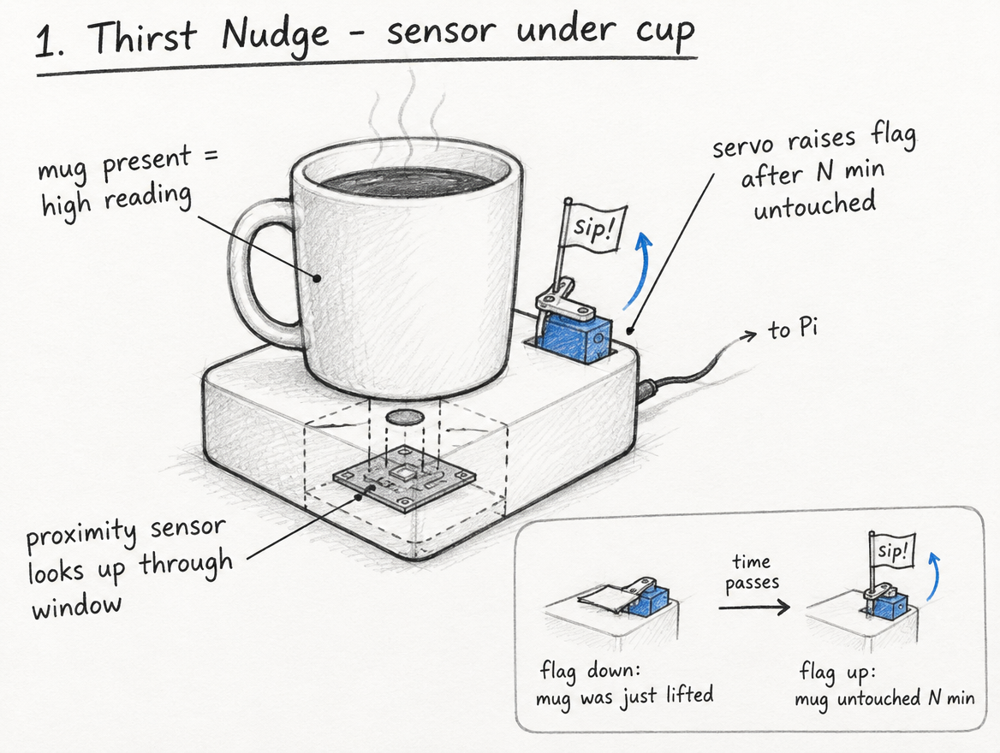
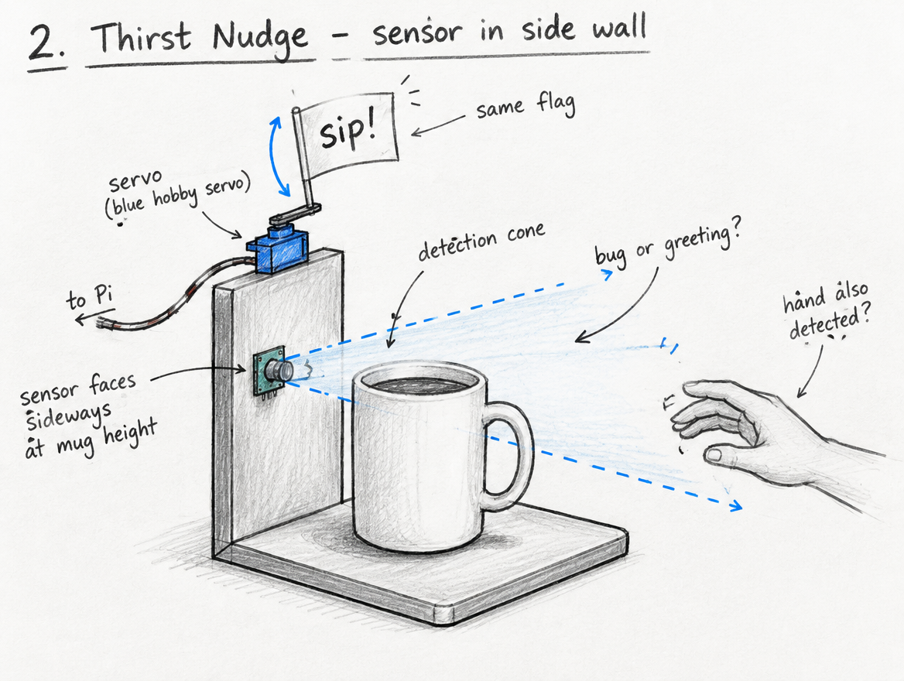
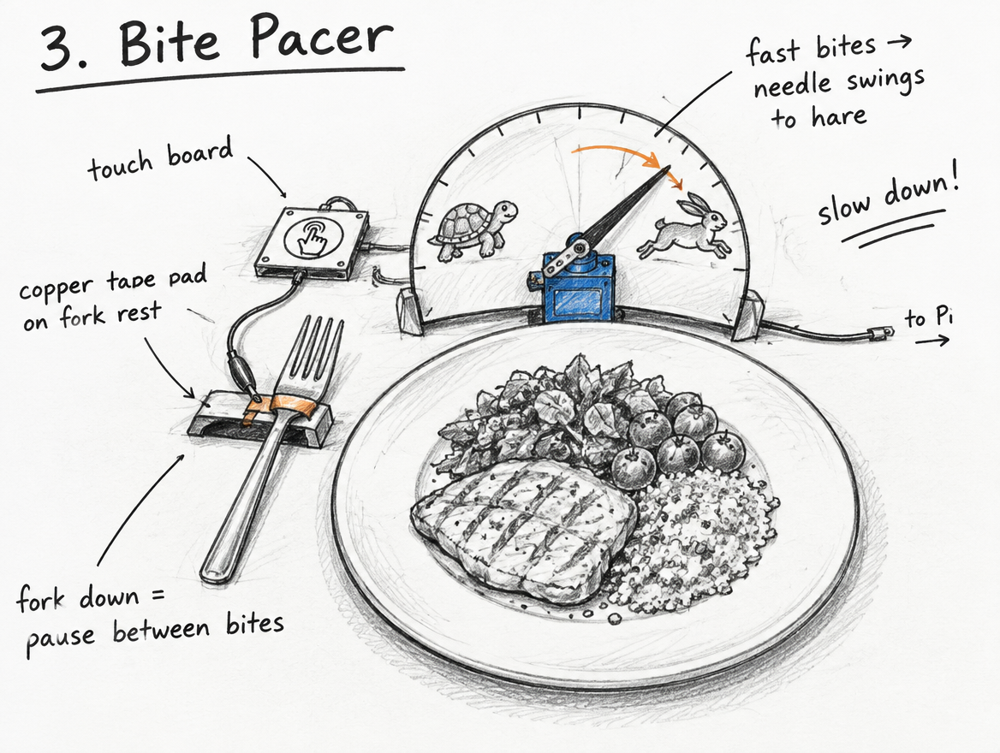
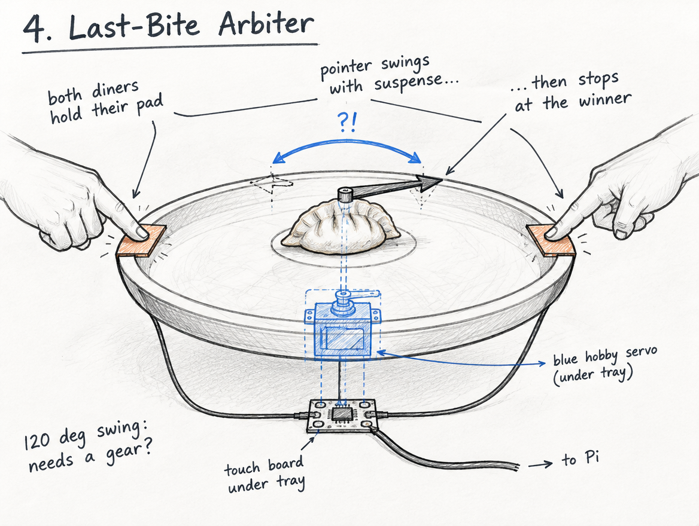
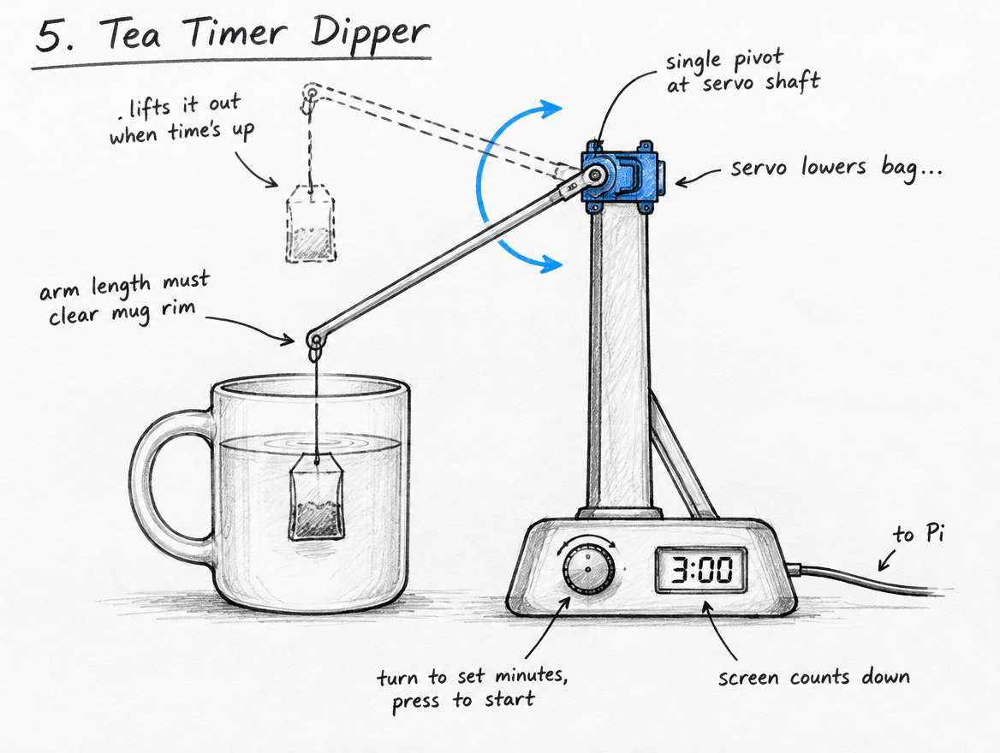

# Ph-UI!!!

**Author:** Pablo Penalba.

For Part 1, I tested each sensor and the servo from the kit one at a time, then designed a Feast Automata concept: the **Thirst Nudge**, a coaster that raises a little "sip!" flag when a drink has sat untouched for too long.

**Design and engineering:** I chose the concepts, sensor placements and final design, did all the physical handling in each hardware test, and built the cardboard prototype. **AI assistance:** Under my direction, Claude helped with Pi setup, ran the test scripts over SSH while I handled the hardware, analyzed the logs, made the two small test-script fixes described below, proposed concept options, wrote the sketch briefs, and drafted this report. The sketch images were made with an AI image generator from those briefs.

# Part 1

## Setup

I used a Raspberry Pi 5 (Debian 12, Python 3.11) with a Lab 4 virtual environment installed from `requirements2025.txt`. `pip check` found no broken requirements, and `blinkatest.py` passed (Digital IO, I2C and SPI ok). The Mini PiTFT sits on the Pi's header and the Servo pHAT stacks on top of it.

For the sensor tests, I first connected each Qwiic board through a Qwiic cable wired to header pins 1, 3, 5 and 6 (3.3 V, SDA, SCL, GND). For the prototype, the sensor plugs into the Servo pHAT's Qwiic port. Before each test I confirmed the board's I2C address, then ran the example script while doing a beep-cued sequence of actions, so every reading could be matched to what I was doing.

## A. Capacitive sensing (MPR121)

The MPR121 was detected at `0x5a`. With an alligator clip on pad 2, `cap_test.py` printed 22 "touched" lines for about 5.5 s of contact, which matched my own estimate of how long I touched it. No other pad fired. In a second run I touched only the clip's plastic cover, three times, and got **zero** detections. The sensor needs bare conductive contact: metal, copper tape, or something conductive like fruit.

## B. More sensors

### Light / proximity / gesture sensor (APDS-9960)

My first APDS-9960 had its power LED on but never answered on I2C, on either of its Qwiic ports. To separate a cable fault from a board fault, I plugged the MPR121 into the same cable and wires, and it was detected right away. The APDS board was faulty, and the replacement board was detected at `0x39`.

- **Proximity (`proximity_test.py`):** the reading sat at 0 with nothing nearby. My three hand approaches produced three clear rise-and-fall peaks (40, 54 and 57) that returned to 0. The range is short: even at about 1 cm the value stayed far below its 255 maximum.
- **Gesture (`gesture_test.py`):** my first two runs (at 5–10 cm and at 2–4 cm) detected nothing. Raw sensor data showed that at 2–4 cm my hand saturated all four light channels, and the library discards saturated data. At **5–8 cm** I made eight swipes, one per beep, and it detected 7, each in a consistent direction. In my orientation left and right are mirrored: a left-to-right swipe prints "left". Away printed "up" and toward printed "down".
- **Color (`color_test.py`):** I held a full-screen red, green and blue phone screen 1–2 cm above the sensor. The matching channel was strongest each time:

  | Light | Red | Green | Blue |
  |---|---|---|---|
  | Room light | 9,450 | 7,935 | 7,640 |
  | Red screen | **6,250** | 700 | 1,135 |
  | Green screen | 3,115 | **6,345** | 2,975 |
  | Blue screen | 316 | 1,463 | **4,870** |

  The script's lux estimate went negative under colored light, so I would use the clear channel for brightness instead.

### Rotary encoder

The encoder was detected at `0x36`. With a beep for each step, five clockwise clicks, five counterclockwise clicks and two presses produced exactly five counts each way, plus two press/release pairs: **one count per click**. The example script counted clockwise as negative on my encoder, so I removed its minus sign in `encoder_test.py`.

### Joystick

The joystick was detected at `0x20`. It rests at about 512/498 and reaches 0 and 1023 at each extreme. In the orientation I held it, pushing away/toward changed X and left/right changed Y, and the button read 0 when pressed. I changed `joystick_test.py` to print X as left/right, Y as toward/away, and the button as 1 when pressed. Pushing right also moved X to about 760, so code should use thresholds rather than exact values.

### Distance sensor (VCNL4040)

The VCNL4040 was detected at `0x60`. The values rise steeply as my hand gets closer, which makes it a good presence detector:

| Hand distance | Reading |
|---|---|
| Nothing near | 0–2 |
| ~10 cm | ~50 |
| ~5 cm | ~250 |
| ~1 cm | 2,000–2,800 |

The script failed to start a few times. Testing showed that about 1 in 100 register writes is rejected, so startup, which makes several writes, fails roughly 1 time in 10. Readings during operation never failed in 300 tries. My prototype code will retry startup.

## C. Servo actuation

The Servo pHAT was detected at `0x40`, with its own USB-C power supply and the servo on channel 0. Instead of the example's endless 0–120° sweep, I first ran a short test: middle, about 20° each way, back to middle. I saw the moves, with no buzzing, jitter or heat. I then stepped the servo through 0°, 30°, 60° and 90° with a paper flag attached, to choose the flag's down and up positions for the prototype.

## D. Physical interaction design: Feast Automata

### Five sketches of different physical arrangements

Each sketch pairs one sensor I tested in Parts A–B with the servo from Part C. Sketches 1 and 2 are the same idea with the sensor in two different places, so I can compare how placement changes the interaction.

**1. Thirst Nudge, sensor under the cup.** The proximity sensor (VCNL4040) looks up through a window in the coaster. If the mug sits untouched for N minutes, the servo raises a "sip!" flag. Lifting the mug resets it.



**2. Thirst Nudge, sensor in a side wall.** Same flag, but the sensor sits in a short wall at mug height and faces sideways. It sees the mug, and also any hand reaching for it.



**3. Bite Pacer.** A copper-tape pad on the fork rest is wired to the capacitive touch sensor (MPR121), so setting the fork down marks a pause between bites. The servo moves a needle on a turtle/hare dial: fast bites swing it toward the hare.



**4. Last-Bite Arbiter.** Two copper pads sit on opposite sides of a serving tray. When both diners hold their pad, a servo-driven pointer swings back and forth, then stops at whoever gets the last bite.



**5. Tea Timer Dipper.** I set the steeping minutes with the rotary encoder and press it to start, and a small screen counts down. A servo arm lowers the tea bag into the mug and lifts it out when time is up.



*AI assistance: Claude helped develop concept options, write the sketch briefs and draft this section; the sketch images were made with an AI image generator from those briefs. I chose the concepts, sensor placements and final design.*

### What questions do these sketches raise? What do I need to physically prototype to answer them?

I sorted each sketch's open questions using Houde and Hill's three kinds of design question:
- **Role:** what the device does in someone's meal.
- **Look and feel:** what people see, hear and feel.
- **Implementation:** how it actually works.

Some answers come from my sensor tests: the VCNL4040 reads about 50 at 10 cm and about 250 at 5 cm; the touch sensor needs bare metal; the servo moves roughly 120°.

| Sketch | Role | Look and feel | Implementation |
|---|---|---|---|
| 1. Thirst Nudge (under cup) | Is a flag a friendly reminder or nagging? How long should N be? | Is a small flag noticeable during a conversation? | Does the sensor read the mug reliably through the coaster window, including mugs with thick or uneven bases? |
| 2. Thirst Nudge (side wall) | Is reacting to a reaching hand a bug or a welcome "greeting"? | Does a tall wall make the coaster feel bulky? | Can a threshold tell the mug from a passing hand? A hand at 10 cm already read about 50 in my test; I haven't measured a mug yet. |
| 3. Bite Pacer | Does pacing feedback help, or feel judgmental? | Is the turtle/hare dial readable at a glance from the seat? | Is the fork rest the right place to sense, or the fork itself? The touch sensor needs bare metal, and the clip cover blocked touches in my test. |
| 4. Last-Bite Arbiter | Does a machine decision feel fair, and fun enough to accept? | How long should the suspense swing last? | Can a ~120° servo point clearly at two people on opposite sides, or does it need a gear? |
| 5. Tea Timer Dipper | Is automating a short ritual worth a device on the table? | Does the slow dip read as calm or mechanical? | What arm length and angle clear a real mug rim, and can a 9g servo hold a wet tea bag steady? |

Houde and Hill recommend building several small, focused prototypes rather than one complete one too early. For these sketches, that means three quick tests:
- **Implementation:** a cardboard coaster with the proximity sensor tried in both placements (sketches 1 and 2), logging readings with a mug, without a mug, and with a hand passing.
- **Look and feel:** a paper flag or needle taped to the servo arm, to judge visibility and motion speed.
- **Role:** a short role-play during a real meal or drink, to see whether the nudge or pacing feels helpful.

### The design I picked, and why

How the five compare (my assessment):

| Sketch | Tested parts it uses | What cardboard can answer quickly | Main risk |
|---|---|---|---|
| 1. Thirst Nudge (under cup) | VCNL4040 + servo | Sensor through a window, flag visibility | Low; closest to the windmill coaster example |
| 2. Thirst Nudge (side wall) | VCNL4040 + servo | Mug vs. hand detection | Telling a mug from a hand |
| 3. Bite Pacer | MPR121 + servo | Where to sense, dial readability | Bare-metal contact; judgmental tone |
| 4. Last-Bite Arbiter | MPR121 + servo | Suspense timing, pointer clarity | Servo range |
| 5. Tea Timer Dipper | Encoder + screen + servo | Arm geometry over a real mug | Arm clearance and load |

I picked **sketch 1, Thirst Nudge with the sensor under the cup**.
- **It uses parts I have already tested.** The VCNL4040 reads clearly from 1 to 10 cm (about 50 at 10 cm, 250 at 5 cm, 2000+ at 1 cm). The servo has already made controlled moves on channel 0.
- **Sensing from below avoids the hand problem.** The side-wall version (sketch 2) also sees reaching hands. With the sensor under the mug, it mostly sees the mug itself.
- **Cardboard can answer its most important questions quickly.** A cardboard coaster with a window and a paper flag on the servo is enough to test whether the sensor reads the mug through the window (implementation), whether the flag is noticeable (look and feel), and whether the reminder feels friendly or nagging (role).

If it works, sketch 2 can be tested with the same cardboard base, by moving the sensor to a wall.

### Rough prototype


I built the coaster from cardboard, with a small hole in the top layer and the VCNL4040 taped underneath, facing up through it. A paper "sip!" flag on a toothpick is taped to the servo horn. With a beep for each step, I measured the sensor through the window:

| Situation | Reading |
|---|---|
| No mug | ~49 |
| My mug on the coaster | ~12,100 (steady) |
| Mug lifted about 5 cm | 190–1,000 |
| Mug removed, my hand passing about 10 cm above | 48–72 |

A resting mug reads about 250 times higher than the empty coaster, and my hand barely registers. That confirms the under-the-cup placement avoids the hand problem. A threshold around 3,000 separates "mug on the coaster" from lifted or absent with a wide margin on both sides. I measured only my own mug, so a different mug should be checked once.

*Reference: Houde, S., & Hill, C. (1997). What do prototypes prototype? In M. Helander, T. Landauer, & P. Prabhu (Eds.), Handbook of Human-Computer Interaction (2nd ed.). Elsevier.*

# Part 2

<details>
<summary><strong>Part 2 instructions (to be replaced with my Part 2 work)</strong></summary>

Following exploration and reflection from Part 1, complete the "looks like," "works like" and "acts like" prototypes for your design, reiterated below.

---

### Part E

#### Build & Integrate: Sensing + Actuation

For Part 2, build the Feast Automata interaction you developed in Part D by connecting sensing/input to physical actuation.

**Your prototype should:**
- Use at least one sensing or input device.
- Use servo-based physical actuation.
- Connect sensing and actuation into a meaningful interaction around eating, drinking, cooking, serving, or sharing food.
- Additional inputs, displays, LEDs, buttons, or other outputs are optional extensions.

**Document your system with:**
- Code for your sensing + actuation prototype
- Photos and/or video of the working prototype in action
- A simple interaction diagram or sketch showing how sensing and actuation are connected
- Written reflection: What did you learn about connecting sensing, movement, and physical form? What was fun, surprising, or challenging?

**Questions to consider:**
- How does your chosen sensor or input shape the physical response?
- How does the physical arrangement of the sensor and actuator change the interaction?
- What thresholds, timing, or movement patterns make the interaction feel clear or playful?
- What changes when you adjust the sensor placement or servo motion?

Iterate on the sensing, movement, and physical form, and document what you discover.

See encoder_accel_servo_dashboard.py in the Lab 4 folder for an optional example of chaining together three devices.

**`Lab 4/encoder_accel_servo_dashboard.py`**

#### Example Application: Windmill Coaster

Now that you have explored both sensing and actuation, here is a simple example that combines the two.

The **Windmill Coaster** uses a Qwiic distance/proximity sensor to detect when a cup is placed on a coaster. When the cup is detected, a servo motor animates a small windmill by sweeping it back and forth, turning an ordinary action during drinking into a playful physical interaction.

<p align="center">
    
</p>


This example demonstrates a simple interaction pipeline:

**cup placed → distance sensor detects cup → servo actuates windmill**

Connect the Qwiic distance sensor to the Pi and connect the servo to Channel 0 of the Servo pHAT. Make sure the Servo pHAT is powered through its USB-C connection.

Run the example script:

```bash
python windmill_coaster.py
```

The script continuously reads the proximity value from the distance sensor. When the value passes a threshold, the servo begins animating the windmill. When the cup is removed, the servo stops and returns to its resting position.

You may need to adjust `CUP_THRESHOLD` in [`windmill_coaster.py`](windmill_coaster.py) depending on the size of your cup and the physical placement of the sensor. You can run `qwiic_distance.py` first to compare readings with and without a cup.

Use this example as a starting point. Change the sensor, movement, physical form, or dining interaction to create your own Feast Automata variation.

#### Optional Extensions

The following examples are optional resources if you want to add more inputs or outputs to your prototype.

##### Using Multiple Qwiic Buttons: Changing I2C Address (Physically & Digitally)

If you want to use more than one Qwiic Button in your project, you must give each button a unique I2C address. There are two ways to do this:

##### 1. Physically: Soldering Address Jumpers

On the back of the Qwiic Button, you'll find four solder jumpers labeled A0, A1, A2, and A3. By bridging these with solder, you change the I2C address. Only one button on the chain can use the default address (0x6F).

**Address Table:**

| A3 | A2 | A1 | A0 | Address (hex) |
|----|----|----|----|---------------|
|  0 |  0 |  0 |  0 |    0x6F       |
|  0 |  0 |  0 |  1 |    0x6E       |
|  0 |  0 |  1 |  0 |    0x6D       |
|  0 |  0 |  1 |  1 |    0x6C       |
|  0 |  1 |  0 |  0 |    0x6B       |
|  0 |  1 |  0 |  1 |    0x6A       |
|  0 |  1 |  1 |  0 |    0x69       |
|  0 |  1 |  1 |  1 |    0x68       |
|  1 |  0 |  0 |  0 |    0x67       |
| ...| ...| ...| ... |     ...      |

For example, if you solder A0 closed (leave A1, A2, A3 open), the address becomes 0x6E.

**Soldering Tips:**
- Use a small amount of solder to bridge the pads for the jumper you want to close.
- Only one jumper needs to be closed for each address change (see table above).
- Power cycle the button after changing the jumper.

##### 2. Digitally: Using Software to Change Address

You can also change the address in software (temporarily or permanently) using the example script `qwiic_button_ex6_changeI2CAddress.py` in the Lab 4 folder. This is useful if you want to reassign addresses without soldering.

Run the script and follow the prompts:
```bash
python qwiic_button_ex6_changeI2CAddress.py
```
Enter the new address (e.g., 5B for 0x5B) when prompted. Power cycle the button after changing the address.

**Note:** The software method is less foolproof and you need to make sure to keep track of which button has which address!


##### Using Multiple Buttons in Code

After setting unique addresses, you can use multiple buttons in your script. See these example scripts in the Lab 4 folder:

- **`qwiic_1_button.py`**: Basic example for reading a single Qwiic Button (default address 0x6F). Run with:
	```bash
	python qwiic_1_button.py
	```

- **`qwiic_button_led_demo.py`**: Demonstrates using two Qwiic Buttons at different addresses (e.g., 0x6F and 0x6E) and controlling their LEDs. Button 1 toggles its own LED; Button 2 toggles both LEDs. Run with:
	```bash
	python qwiic_button_led_demo.py
	```

Here is a minimal code example for two buttons:
```python
import qwiic_button

# Default button (0x6F)
button1 = qwiic_button.QwiicButton()
# Button with A0 soldered (0x6E)
button2 = qwiic_button.QwiicButton(0x6E)

button1.begin()
button2.begin()

while True:
		if button1.is_button_pressed():
				print("Button 1 pressed!")
		if button2.is_button_pressed():
				print("Button 2 pressed!")
```

For more details, see the [Qwiic Button Hookup Guide](https://learn.sparkfun.com/tutorials/qwiic-button-hookup-guide/all#i2c-address).

---

##### PCF8574 GPIO Expander: Add More Pins Over I²C

Sometimes your Pi’s header GPIO pins are already full (e.g., with a display or HAT). That’s where an I²C GPIO expander comes in handy.

We use the Adafruit PCF8574 I²C GPIO Expander, which gives you 8 extra digital pins over I²C. It’s a great way to prototype with LEDs, buttons, or other components on the breadboard without worrying about pin conflicts—similar to how Arduino users often expand their pinouts when prototyping physical interactions.

**Why is this useful?**
- You only need two wires (I²C: SDA + SCL) to unlock 8 extra GPIOs.
- It integrates smoothly with CircuitPython and Blinka.
- It allows a clean prototyping workflow when the Pi’s 40-pin header is already occupied by displays, HATs, or sensors.
- Makes breadboard setups feel more like an Arduino-style prototyping environment where it’s easy to wire up interaction elements.

**Demo Script:** `Lab 4/gpio_expander.py`

<p align="center">
    
</p>

We connected 8 LEDs (through 220 Ω resistors) to the expander and ran a little light show. The script cycles through three patterns:
- Chase (one LED at a time, left to right)
- Knight Rider (back-and-forth sweep)
- Disco (random blink chaos)

Every few runs, the script swaps to the next pattern automatically:
```bash
python gpio_expander.py
```

This is a playful way to visualize how the expander works, but the same technique applies if you wanted to prototype buttons, switches, or other interaction elements. It’s a lightweight, flexible addition to your prototyping toolkit.

---


---

---

### Part F

### Final Documentation

Document all the prototypes and iterations you have designed and worked on! Again, deliverables for this lab are writings, sketches, photos, and videos that show what your prototype:
* "Looks like": shows how the device should look, feel, sit, weigh, etc.
* "Works like": shows what the device can do
* "Acts like": shows how a person would interact with the device

---

## Deliverables \& Submission for Lab 4

The deliverables for this lab are, writings, sketches, photos, and videos that show what your prototype:
* "Looks like": shows how the device should look, feel, sit, weigh, etc.
* "Works like": shows what the device can do.
* "Acts like": shows how a person would interact with the device.

For submission, the readme.md page for this lab should be edited to include the work you have done:
* Upload any materials that explain what you did, into your lab 4 repository, and link them in your lab 4 readme.md.
* Link your Lab 4 readme.md in your main Interactive-Lab-Hub readme.md. 
* Labs are due on Mondays, make sure to submit your Lab 4 readme.md to Canvas.

</details>
