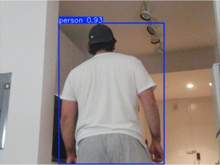
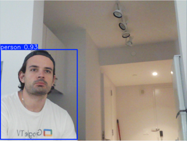
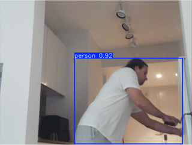
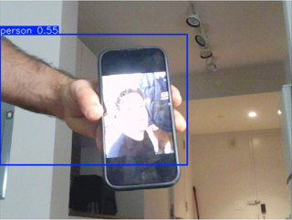
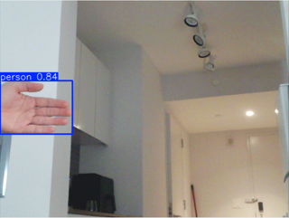
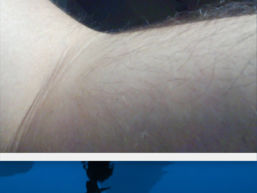
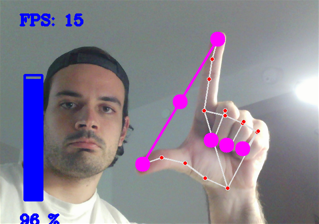
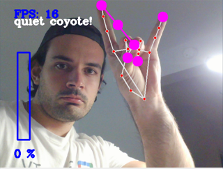
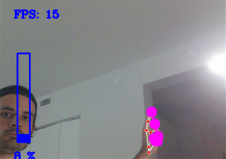
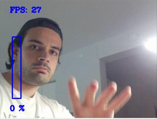

# Observant Systems: Overnight Sensation

**Members:** Pablo Penalba (pp555)

**Project name:**

<details>
	<summary><strong>Instructions for Students (Click to Expand)</strong></summary>
  
	**Submission Cleanup Reminder:**
	- This README.md contains extra instructional text for guidance.
	- Before submitting, remove all instructional text and example prompts from this file.
	- You may delete these sections or use the toggle/hide feature in VS Code to collapse them for a cleaner look.
	- Your final submission should be neat, focused on your own work, and easy to read for grading.
  
	This helps ensure your README.md is clear, professional, and uniquely yours!
</details>


For lab this week, we focus on creating interactive systems that can detect and respond to events or stimuli in the environment of the Pi, like the Boat Detector we mentioned in lecture. 
Your **observant device** could, for example, count items, find objects, recognize an event or continuously monitor a room.

This lab will help you think through the design of observant systems, particularly corner cases that the algorithms need to be aware of.

**New this year: the AI runs on the Pi.** Your Pi 5 can run an object detector ([YOLO](https://docs.ultralytics.com/)) and a small language model ([Qwen](https://ollama.com/library/qwen3.5) through [Ollama](https://ollama.com)) completely offline. In Part 1 you get both running and connect them: YOLO *sees*, Qwen *reasons* about what was seen. These models are slow, but they have all night. In Part 2 you use them to design a **night-time interaction**: what you tell the device before bed, what it does while you sleep, and what it shows you when you wake up.

**Please indicate anyone that helped with this Lab here.**
Be generous in acknowledging their contributions! And also recognizing any other influences (e.g. from YouTube, Github, Twitter) that informed your design. 

## Overview

**Part 1: the tools**

A) [Set up your Pi for on-device AI](#part-a)

B) [See: recognize people in real time with YOLO](#part-b)

C) [See more: hands and pose with MediaPipe](#part-c)

D) [Reason: run Qwen on the Pi with Ollama](#part-d)

E) [Connect: from YOLO readings to Qwen reasoning](#part-e)

**Part 2: Overnight Sensation**

F) [Read Part 2 and storyboard your night-time interaction](#part-f)

G) [Design the interaction before bed](#part-g)

H) [Incorporate the observant system during sleep](#part-h)

I) [Design the interaction when awake](#part-i)

The tools from earlier versions of this lab (MobileNet, Teachable Machine, Moondream, audio analysis, classic OpenCV) live in the [legacy folder](legacy/README.md). They are optional, but any of them can be the sensor in your Part 2 system.


## Prep for Part 1

Please check the instructions in [prep.md](prep.md) and complete them before lab. The installs in Part A take a while, so prep.md also tells you how to get a head start.

## The Report

This readme.md page in your own repository should be edited to include the work you have done. You can delete everything but the headers and the sections between the \*\*\***stars**\*\*\*. Write the answers to the questions under the starred sentences. Include any material that explains what you did in this lab hub folder, and link it in the readme.

---

# Part 1

## Part A. 
### Set up your Pi for on-device AI

Create a virtual environment and install the requirements. They include `ultralytics` (YOLO), which pulls in torch, so this takes a while:

```
pi@raspberrypi:~$ cd Interactive-Lab-Hub/Lab\ 5
pi@raspberrypi:~/Interactive-Lab-Hub/Lab 5 $ python3 -m venv .venv
pi@raspberrypi:~/Interactive-Lab-Hub/Lab 5 $ source .venv/bin/activate
(.venv) pi@raspberrypi:~/Interactive-Lab-Hub/Lab 5 $ pip install -r requirements.txt
```

As in Lab 3, [`uv`](https://docs.astral.sh/uv/) is a much faster drop-in for `pip`: `pip install uv && uv pip install -r requirements.txt`.

### YOLO: download the nano model and export it for the Pi

We use the nano model of [YOLO26](https://docs.ultralytics.com/models/yolo26/), exported once to NCNN, the format that runs fastest on the Pi. This downloads the weights:

```
(.venv) pi@raspberrypi:~/Interactive-Lab-Hub/Lab 5 $ python -c "from ultralytics import YOLO; YOLO('yolo26n.pt').export(format='ncnn')"
(.venv) pi@raspberrypi:~/Interactive-Lab-Hub/Lab 5 $ yolo export model=yolo26n.pt format=ncnn
```
If every ultralytics message is followed by a `--- Logging error ---` traceback ending in `UnicodeEncodeError: 'latin-1' codec can't encode character`, fix your shell's locale once::

```
echo 'export LANG=C.UTF-8' >> ~/.bashrc
echo 'export LC_ALL=C.UTF-8' >> ~/.bashrc
echo 'export PYTHONIOENCODING=utf-8' >> ~/.bashrc
source ~/.bashrc
```

The second command converts the .pt model to a .ncnn model.

Test it on an image from the internet. `project="$PWD"` keeps the output in `predict` in the current lab folder; without it, ultralytics writes to a `runs/` folder at the top of your git repo, where you will not think to look.

```
(.venv) pi@raspberrypi:~/Interactive-Lab-Hub/Lab 5 $ yolo predict model=yolo26n_ncnn_model source=https://ultralytics.com/images/bus.jpg project="$PWD"
```

The result is in `predict/bus.jpg`: boxes around the people and the bus.

Now a photo of your own. Plug in the webcam and take one with `snap.py` (`--delay 3` gives you three seconds to get into the frame), or choose any picture you downloaded from the internet and put under this folder. Put your selected picture after the `source=` Then run the same command on it:

```
(.venv) pi@raspberrypi:~/Interactive-Lab-Hub/Lab 5 $ python snap.py --delay 3
(.venv) pi@raspberrypi:~/Interactive-Lab-Hub/Lab 5 $ yolo predict model=yolo26n_ncnn_model source=snap.jpg project=runs
```

Every run gets its own numbered folder, so this one is in `runs/predict2/snap.jpg`; the command prints where it saved. Keep `snap.jpg`, you will show it to Qwen in Part D.

### Ollama: install it and pull Qwen

[Ollama](https://ollama.com) runs language models locally. Nothing leaves the Pi: no API key, no internet after the download.

```
pi@raspberrypi:~ $ curl -fsSL https://ollama.com/install.sh | sh
pi@raspberrypi:~ $ ollama pull qwen3.5:0.8b
pi@raspberrypi:~ $ ollama pull qwen3:0.6b
pi@raspberrypi:~ $ ollama list
```

| model | download | what it does |
|---|---|---|
| `qwen3.5:0.8b` | ~1.3 GB | text **and images**; the one we use in this lab |
| `qwen3:0.6b` | ~0.5 GB | text only, smaller and faster (~16 tokens/s on a Pi 5) |

\*\*\***Include a screenshot of `ollama list` showing your models.**\*\*\*


## Part B. 
### See: recognize people in real time with YOLO

YOLO is an *object detector*: it finds every person, cup, cat and so on (the 80 [COCO](https://cocodataset.org/) classes), draws a box around each, and gives a confidence. For an observant system that is exactly what you want: *how many*, *where*, *how sure*.

Connect your webcam, connect to your Pi through **VNC** (the script opens a window), and run the person detector. Read `yolo_person.py` first; the loop at the bottom is the whole idea.

```
(.venv) pi@raspberrypi:~/Interactive-Lab-Hub/Lab 5 $ python yolo_person.py
```

While it runs, walk in and out of the frame, sit down, turn your back, hold up a photo of a person on your phone. Watch the confidence number on the box change with each.

Then press q to quit and run it again with a flag. Each one changes a single thing:

```
(.venv) pi@raspberrypi:~/Interactive-Lab-Hub/Lab 5 $ python yolo_person.py --conf 0.2     # lower the bar: see what the model is unsure about
(.venv) pi@raspberrypi:~/Interactive-Lab-Hub/Lab 5 $ python yolo_person.py --conf 0.7     # raise the bar: see what you lose
(.venv) pi@raspberrypi:~/Interactive-Lab-Hub/Lab 5 $ python yolo_person.py --all          # all 80 classes, not only people: what else is on your desk, and what does it get wrong?
(.venv) pi@raspberrypi:~/Interactive-Lab-Hub/Lab 5 $ python yolo_person.py --headless     # no window, only the printed readings: how it runs over ssh, and at night
```

\*\*\***Include a short video or screenshots of your experiments with the person detection. Write down three situations where it did not see you, or saw a person who was not there, and what you think the cause was.**\*\*\*

I ran seven 20-second trials on the Pi 5 with the webcam on my desk, each with a spoken cue telling me what to do: walking in and out, turning my back, holding up a phone photo, showing only part of my body, sitting close and then moving to the far side of the room, holding up objects with `--all`, and sitting still with `--headless`. With the window open, the detector ran at about 6.5 readings per second; headless it ran at about 8.5.

  

*Back turned (0.93), close to the camera (0.93), and at the far side of the room (0.92).*

What worked better than I expected: turning my back did not fool it at all (0.89–0.94 on every frame), and raising the bar to `--conf 0.7` did not lose me even at the far side of the room, where my box shrank from 479 px to 151 px tall.

**Failure modes**

  

*Phone photo (person 0.55), a hand alone (person 0.84), and my arm covering the lens (nothing).*

1. **It saw a person who was not there: a photo on my phone.** With me out of frame and only my phone photo visible, it reported a person at 0.40–0.83, and often two or three "people" at once: the photo, plus my hand and arm as separate partial people. My guess at the cause: YOLO matches what a person looks like in a flat image. It has no sense of depth or liveness, so a picture of a person *is* a person to it.
2. **A hand alone became a whole person.** With `--conf 0.2`, my hand at the edge of the frame was detected as "person" at 0.84. The person class includes partial bodies, so this is "correct" for YOLO, but in Part E's interpreter the hand would become `1 person(s) at left/far`, because the box is small. A small box no longer means far away.
3. **It did not see me when I was too close.** While I was adjusting the camera during a setup run, my arm covered the lens and it reported 0 people, even though I was right there. My guess: at that range there is no recognizable body outline, just skin and blur.
4. **With `--all`, it misnamed my objects.** I held up a water glass and a milk bottle. The milk bottle was detected as "bottle" (0.41–0.93), but the water glass kept flipping between "cup" and "wine glass" (0.40–0.52) from frame to frame. My phone was never labeled "cell phone"; it showed up twice as "remote". There were also single-frame labels for "sink" and "laptop". My guess: the objects are small at the model's 320 px input size, and a clear glass has few features, so the label changes between similar classes.

## Part C. 
### See more: hands and pose with MediaPipe

YOLO tells you that a person is there. Google's [MediaPipe](https://mediapipe.dev/) tells you what their hands and body are doing: face, hand and body pose detection, fast on the Pi.


The demo plays a looping audio file, so make the helper script executable first:

```
(.venv) pi@raspberrypi:~/Interactive-Lab-Hub/Lab 5 $ chmod +x loop_audio.sh
```

Connect your webcam, connect to your Pi through **VNC**, and run the hand pose script:
(***it will not work if you use ssh from your laptop***)

```
(.venv) pi@raspberrypi:~/Interactive-Lab-Hub/Lab 5 $ python hand_pose.py
```

Try the two main features of this script: 1) pinching for percentage control (the thumb-to-index distance sets the volume), and 2) "[Quiet Coyote](https://www.youtube.com/watch?v=qsKlNVpY7zg)" for instant percentage setting (the gesture mutes it). Notice how this example uses hardcoded positions and relates those positions with a desired set of events, in `hand_pose.py`: a hand is 21 landmark coordinates, and an *event* is a rule you write over them. That is the same job as `interpret()` in Part E.

Consider how you might use this position based approach to create an interaction, and write how you might use it on either face, hand or body pose tracking.

\*\*\***Include a screenshot or short video of the hand pose demo, and write how you might use face, hand or body pose tracking in your observant system.**\*\*\*

I ran three 25-second trials of `hand_pose.py` on the Pi 5: the pinch volume control, the Quiet Coyote, and the same pinch close to the camera and then at arm's length. MediaPipe tracked my hand at about 15 frames per second. I had no speaker connected, so I followed the volume on the on-screen bar.

 

*An open pinch set the volume to 96%; the Quiet Coyote muted it.*

The pinch worked as designed: the bar followed my thumb and index finger through 96%, 58%, 50% and 0%. The Quiet Coyote was recognized whenever I made it, and I did not see it trigger on any other pose. Two things broke:

 

*At arm's length, a fully open pinch only reached 8%. A moving open hand was not detected at all.*

* **Distance changes the meaning of a gesture.** The rules are written in pixels: volume maps a 50–300 px thumb-to-index gap, and the Quiet Coyote checks for gaps over or under 100 px. At arm's length my whole hand is small, so a fully open pinch only reached about 60–135 px and the bar stayed at 0–8%. Close to the camera, with my hand partly over my face, the landmarks bunched up and read as a closed pinch. Measuring gaps relative to the size of the hand (for example, the wrist-to-knuckle length) would make the same gesture mean the same thing at any distance.
* **A moving hand can disappear.** When I opened my hand and moved it, MediaPipe found no hand at all, and the volume simply stayed where it was (muted). The system does nothing when it sees nothing, so a missed gesture is silent.

**How I would use it in my observant system:** the Quiet Coyote becomes the on/off switch for the night. At bedtime I make the gesture at the device, and it starts timing my sleep. In the morning I make the same gesture again, and it stops and reports how long I slept. A deliberate, unusual hand shape is a good trigger because I would not make it by accident. The camera only needs to see my hand at the device, not my bed. From these trials, I would require the gesture to be held for about a second before it counts, use hand-size-relative distances so it works wherever I stand, and give a clear acknowledgement (a tone or a dimming light) so I know it registered, because a missed gesture is otherwise invisible.

## Part D. 
### Reason: run Qwen on the Pi with Ollama

Talk to the model in the terminal first. Qwen3 models "think" before they answer, which is slow on a Pi, so turn it off. Then ask about something you can check:

```
pi@raspberrypi:~ $ ollama run qwen3.5:0.8b
>>> /set nothink
>>> Tell me a bit about the history of Roosevelt Island. Three sentences.
>>> /bye
```

Roosevelt Island is a good first question because you know the ground truth: it was Blackwell's Island, then Welfare Island, got its current name in 1973, and Cornell Tech opened on it in 2017. Count how many of the model's facts are true.

From Python, qwen requests can be triggered by the `ask_qwen.py` script. It turns thinking off, tells the model to answer in at most three sentences, and cuts it off after 120 tokens (`--max-tokens` changes that), because a small model left alone writes an essay. Read the script, then run:

```
(.venv) pi@raspberrypi:~/Interactive-Lab-Hub/Lab 5 $ python ask_qwen.py "Tell me a bit about the history of Roosevelt Island."
(.venv) pi@raspberrypi:~/Interactive-Lab-Hub/Lab 5 $ python ask_qwen.py --model qwen3:0.6b "Tell me a bit about the history of Roosevelt Island."
(.venv) pi@raspberrypi:~/Interactive-Lab-Hub/Lab 5 $ python ask_qwen.py --image snap.jpg "What is in this photo?"
```

Things in the [Ollama API](https://github.com/ollama/ollama/blob/main/docs/api.md) worth knowing:

* `think: false` skips the reasoning trace. Always, on a Pi. `ask_qwen.py` sends it on every request; `--think` turns the trace back on for one question, so you can see what you are skipping and how long it takes.
* `format` makes the model answer as JSON with the fields you name (`--json`). Handy when a display or a servo has to read the answer.
* `images` sends a photo along with the prompt (`--image snap.jpg`, the photo from Part A). `qwen3.5:0.8b` can look at pictures.

A 0.8B model is slow and sometimes wrong. It will invent events that are not in the data and agree with a wrong premise. Give it the data, keep its job narrow, and decide what the device does when the model is unsure.

\*\*\***Ask Qwen three questions to answer. Paste the questions, the answers and how long each took. Try one of them with `qwen3:0.6b` and compare.**\*\*\*

I asked three questions whose answers I can check, through `ask_qwen.py` (thinking off, at most three sentences, 120 tokens), first with `qwen3.5:0.8b` and then all three again with `qwen3:0.6b`. The second question is the arithmetic my sleep timer from Part C would need. The third has a wrong premise on purpose: Cornell Tech opened on Roosevelt Island in 2017, not 2005.

| Question | Correct answer | `qwen3.5:0.8b` | `qwen3:0.6b` |
|---|---|---|---|
| Tell me a bit about the history of Roosevelt Island. | Blackwell's Island, then Welfare Island, renamed for FDR in 1973; Cornell Tech in 2017 | **Wrong** (17.7 s): a private residence of William Henry Harrison, named by Theodore Roosevelt for his grandfather | **Wrong** (13.8 s): "located in the Pacific Ocean", a 1922 Navy refuge |
| If I go to bed at 11:40 pm and wake up at 7:15 am, how long did I sleep? | 7 h 35 min | **Wrong** (10.0 s): 16 h 25 min | **Wrong** (0.9 s): 13 h 30 min |
| Why did Cornell Tech open its Roosevelt Island campus in 2005? | It opened in 2017 | **Accepted the wrong year** (6.1 s) and invented a reason (affordable education for lower-income areas) | **Accepted the wrong year** (2.6 s) and invented a reason |
| *Image:* `--image snap.jpg` "What is in this photo?" | Me, in a backwards black cap, seen from below | **Mostly right** (31.7 s): "A man wearing a black cap and looking down into the camera." | (text only) |

<details>
<summary>Full answers</summary>

**Roosevelt Island, qwen3.5:0.8b (17.7 s):** Roosevelt Island was originally built as a private residence for William Henry Harrison, who died there in 1840. The island's name was later adopted by President Theodore Roosevelt to honor his grandfather, and it became a major tourist destination in the early 20th century.

**Roosevelt Island, qwen3:0.6b (13.8 s):** Roosevelt Island, located in the Pacific Ocean, was established in 1922 as a temporary refuge for the U.S. Navy. It was initially a temporary naval base and later became a significant research site for the U.S. government and the National Oceanographic and Atmospheric Administration. Today, it remains a symbol of the U.S. commitment to environmental protection and international collaboration.

**Sleep time, qwen3.5:0.8b (10.0 s):** I calculate the time difference between your wake-up time (7:15 am) and your bedtime (11:40 pm). Subtracting these two times gives you a total duration of 16 hours and 25 minutes. This means you slept for approximately 16.4 hours.

**Sleep time, qwen3:0.6b (0.9 s):** You slept for 13 hours and 30 minutes.

**Cornell Tech 2005, qwen3.5:0.8b (6.1 s):** Cornell Tech opened the Roosevelt Island campus to provide students with a more affordable and accessible education for those living in lower-income areas of New York City.

**Cornell Tech 2005, qwen3:0.6b (2.6 s):** Cornell Tech opened its Roosevelt Island campus in 2005 to provide a more convenient and accessible educational experience for students and professionals, especially in the region. The campus is designed to support the growth of the university and its community.

**Photo, qwen3.5:0.8b (31.7 s):** A man wearing a black cap and looking down into the camera.
</details>

Out of six text answers, none was correct. Both models wrote confident, fluent sentences with invented facts, both got the sleep arithmetic wrong (and differently from each other), and both accepted the wrong year and made up a reason for it. The 0.6b model was faster (0.9–13.8 s vs 6.1–17.7 s; the first 0.8b answer includes loading the model), but not more accurate; it put Roosevelt Island in the Pacific Ocean. The image answer was the best one: it described what it actually saw, even though it took the longest (31.7 s).

What this means for my system: Qwen should never compute or recall anything that matters. My sleep timer will calculate the duration in Python from the two gesture timestamps and give Qwen the finished number, so its only job is to put the facts I give it into a friendly sentence. I will also check its morning report against the log, because it will invent events as readily as it invented Roosevelt Island's history.


## Part E. 
### Connect: from YOLO readings to Qwen reasoning

An observant system is a pipeline: a **detector** turns pixels into boxes, an **interpreter** turns boxes into readings in words ("one person, left, close"), the readings pile up in a **log**, and a **reasoner** answers a question about the log. The language model never sees pixels, only the words you chose in the interpreter. That makes the interpreter the most important design decision in the system.

`yolo_to_qwen.py` is the pipeline in one file, one function per stage. Read it before you run it:

* `interpret(r)` is the interpreter. It takes one YOLO result and returns one reading. A person is *left*, *center* or *right* by which third of the frame the middle of their box is in, and *close* if the box is taller than 60% of the frame, *far* otherwise. The reading is a string like `1 person(s) at center/close`, or `nobody`. Fifteen lines, and they decide everything the model can know.
* `watch(seconds)` is the detector and the log. Twice a second it reads a frame, runs YOLO on it and calls `interpret()`. A time-stamped reading goes into the log **only when it differs from the previous one**, so a minute of sitting still is one line, not 120.
* `ask(log, question)` is the reasoner. It pastes the log and your question into one prompt, tells Qwen to answer in at most three sentences using only what is in the log, and sends it to Ollama with thinking off.

Run it through VNC and a window opens with YOLO's boxes, the current reading and the seconds left. Press q to stop watching early. Over plain ssh add `--headless` and you get the same thing minus the window.

```
(.venv) pi@raspberrypi:~/Interactive-Lab-Hub/Lab 5 $ python yolo_to_qwen.py
```

It watches for a minute, saves the log to `watch_log.txt` and asks Qwen the default question. The terminal looks something like this:

```
14:02:11 nobody
14:02:19 1 person(s) at right/far
14:02:24 1 person(s) at center/close
14:02:51 nobody

4 lines saved to watch_log.txt
asking Qwen...

Qwen (18.4 s):
One person came in from the right, moved close to the camera, and left after about half a minute. ...
```

I ran the pipeline for 60 seconds with a planned sequence: stay out of frame for 10 seconds, walk in and stand back on the camera's right, come close to the center at 25 seconds, and leave at 45 seconds. This is the log it wrote:

```
19:44:22 nobody
19:44:39 1 person(s) at left/close
19:45:15 nobody
```

Qwen (11.6 s): *"There was initially no one present. A single person appeared at 19:44:39 near the left side of the room, but they were gone by 19:45:15. No other activity or changes occurred during this observation period."*

Qwen summarized the log correctly. The log itself, though, lost most of what I did, and the interpreter explains why:

* **I stood on the camera's right, but it logged "left."** Either the webcam mirrors its image (`yolo_to_qwen.py` does not flip it back), or I was not far enough to the right to leave the left third of the frame. This run cannot tell the two apart.
* **I was never "far."** Even standing back, my box was taller than 60% of the frame. I probably wasn't far enough back, and 60% is a lot for a webcam in a small room.
* **Walking to the center left no trace.** I stayed "close" and probably never crossed out of the left third, so the reading never changed, and the log only writes a line when it changes.

Three lines out of a minute of movement: the model can only be as good as the words the interpreter gives it.

**An empty log.** In two earlier runs I was not in front of the camera, and the log was a single `nobody` line. Qwen got the count right both times but padded the answer with things that were not in the log, such as *"a line appeared on the detector's screen at 19:37:17, which indicates a change in state rather than an actual person."* The first of those answers took 88 s, because the model was loading after a reboot. The second took 10.8 s.

**Does it notice contradictions?** I edited the real log by hand to add three impossible lines and fed it back with `--log`:

```
19:44:22 nobody
19:44:39 1 person(s) at left/close
19:44:51 2 person(s) at right/far       <- two people, one position
19:45:02 nobody
19:45:02 1 person(s) at center/close    <- nobody and someone in the same second
19:44:30 1 person(s) at left/far        <- time goes backwards
19:45:15 nobody
```

| Question | Qwen's answer | What's wrong |
|---|---|---|
| The default question (9.6 s) | "There are currently 2 people present in the room. One person was located on the left side of the room, while another was on the right side. No other changes were made to the scene during this observation period." | The log ends with nobody. It merged lines from different times into two people at once, said nothing changed, and noticed none of the contradictions. |
| "Is anything in this log inconsistent or impossible? Point to the lines." (14.2 s) | It flagged that 19:45:02 appears twice, and said the `nobody` at 19:44:22 contradicts the lines "recorded immediately before it." | It found one of the three, and only as a "duplicate entry." The second claim is invented: 19:44:22 is the first line. It missed the backwards timestamp and the two people with one position. |

So the model does not check its input. Asked an open question, it trusts the log completely. Asked to look for problems, it finds some and invents others. For my overnight system, the checks go in code before the prompt: timestamps must move forward, the number of people must match the number of positions, and gaps in the log are reported as gaps. Qwen only gets a log that has already passed those checks.

---

# Lab 5 Part 2: Overnight Sensation

For Part 2, you will use the observant system from Part 1 to design a night-time interaction. On-device AI is slow, so let it work while you sleep. The person meets the device twice: **before bed**, when they hand the night over, and **when awake**, when the device gives something back. In between, the pipeline from Part E runs on its own.

Two flavors, pick one or mix them:

* **Sense all night.** The Pi watches, listens or measures from bedtime until morning and keeps a log.
* **Process all night.** You already have the data (a day of phone photos, a long recording) and the Pi needs hours to get through it.

Two house rules. Sample rather than stream: one look every 5 to 30 seconds is plenty, and it keeps the Pi cool. And keep everything on the Pi: tell the people you live with, point the camera at things rather than at beds, and delete the snapshots after the demo.

## Part F. 
### Read Part 2 and storyboard your night-time interaction

Storyboard a night-time interaction built on your observant system, in three panels:

1. **Before bed.** How does the person hand the night over, and how does the device acknowledge it?
2. **While asleep.** What does the device watch or work through?
3. **When awake.** What is the one thing the person learns, and in what medium?

Stuck? A kitchen that tells you who raided the fridge. A desk that reports whether you actually went to bed. A window that names the quietest hour. A plant that describes its night. Find something better.

Use storyboards and/or [Verplank diagrams](https://ccrma.stanford.edu/courses/250a-fall-2004/IDSketchbok.pdf).

\*\*\***Insert ideas, sketches, Verplank diagrams and storyboards for your night-time interaction here.**\*\*\*

## Prep for Part 2

1. Look at and give feedback on the Part F storyboards.
   **Put the feedback for your ideas here.**
2. [Update your Lab Hub](prep.md#get-the-latest-content) to get the latest content for Part 2.
3. Decide where the device will spend the night and who else lives there. Get their OK before the first run.
4. Revise your storyboard with the feedback and with what you learned in Part E about where the pipeline breaks.

\*\*\***Post your revised storyboard here.**\*\*\*

## Part G. 
### Design the interaction before

The hand-off: the person tells the device what to watch tonight, and the device acknowledges it. Keep it to a thirty-second ritual. A button or a touch (Lab 4), a spoken sentence (Lab 3), a wave or a Quiet Coyote at the camera (Part C). The acknowledgement can be a line on the display, a tone, or an LED that dims rather than lights up. At its simplest, the hand-off just sets the question that the morning will answer.

\*\*\***Describe the interaction before.**\*\*\*

## Part H. 
### Incorporate the observant system

The Part E pipeline becomes the night shift. `overnight.py` runs your `interpret()` from `yolo_to_qwen.py` every few seconds, people only unless you pass `--all`, and writes the readings to `night_log.jsonl`; the reasoning waits for the morning. Start it inside `tmux` so it keeps running after you close your laptop, and stop it with Ctrl-C in the morning:

```
(.venv) pi@raspberrypi:~/Interactive-Lab-Hub/Lab 5 $ tmux new -s night
(.venv) pi@raspberrypi:~/Interactive-Lab-Hub/Lab 5 $ python overnight.py
```

Fake a night first: run it for thirty seconds while you walk around, stop it, and run `morning.py` from Part I. When that looks right, run a real night. If your storyboard needs a sensor rather than the camera, swap in the Lab 4 example code and log its reading the same way.

\*\*\***Screenshots or videos of the running system.**\*\*\*

## Part I. 
### Design the interaction after

The reveal. The night produced a log; the morning turns it into something a half-awake person can take in. `morning.py` is the smallest version: it asks Qwen for a three-sentence report.

```
(.venv) pi@raspberrypi:~/Interactive-Lab-Hub/Lab 5 $ python morning.py
```

Make it yours: show the report on the Mini PiTFT, read it aloud with Piper from Lab 3, plot the night as a timeline, or ask for JSON (`--json`, Part D) and move a servo. Whatever you pick, make sure it is honest about a night in which nothing happened.

## Final documentation

Document all the prototypes and iterations you have designed and worked on. The deliverables for this lab are writings, sketches, photos, and videos that show what your system:

* "Looks like": how the device sits in the room at night, and what it looks like at bedtime and in the morning.
* "Works like": the pipeline from detector to interpreter to log to reasoner, with a real night's data.
* "Acts like": how a person hands the night over and what they get back.

\*\*\***Include a short video of the whole system**\*\*\*

As always, make sure you document contributions and ideas from others (and AI) explicitly in your writeup.

You are permitted (but not required) to work in groups and share a turn in; you are expected to make equal contribution on any group work you do, and N people's group project should look like N times the work of a single person's lab. Make sure the page for the group turn in is linked to your personal Interactive Lab Hub page.

## Deliverables & Submission for Lab 5

For submission, the readme.md page for this lab should be edited to include the work you have done:
* Upload any materials that explain what you did, including your code and night log, into your Lab 5 repository, and link them in your Lab 5 readme.md.
* Labs are due on Sundays, make sure to submit your Lab 5 readme.md to Canvas.

<details>
  <summary><strong>Submission Cleanup Reminder (Click to Expand)</strong></summary>

  **Before submitting your README.md:**
  - This readme.md file has a lot of extra text for guidance.
  - Remove all instructional text and example prompts from this file.
  - You may either delete these sections or use the toggle/hide feature in VS Code to collapse them for a cleaner look.
  - Your final submission should be neat, focused on your own work, and easy to read for grading.
</details>
