# Observant Systems: Overnight Sensation

**Members:** Pablo Penalba (pp555)

**Project name:** Quiet Coyote Sleep Tracker

**AI disclosure:** I designed the Quiet Coyote Sleep Tracker and its interaction, did every trial and user test, and directed and approved all the work. Claude Code helped me set up the Pi, write and debug the code, run the trials, make the storyboards, diagrams, CAD model and concept renders, and draft this report. The lullaby and the alarm song were made with Suno.

**Help:** friends tried the bedtime hand-off for me, and their frustration with setting the alarm time led to the redesign described in [Testing with users](#testing-with-users).

---

# Part 1

## Part A. Set up your Pi for on-device AI

*Include a screenshot of `ollama list` showing your models.*


## Part B. See: recognize people in real time with YOLO

*Include a short video or screenshots of your experiments with the person detection. Write down three situations where it did not see you, or saw a person who was not there, and what you think the cause was.*

I ran seven 20-second trials on the Pi 5 with the webcam on my desk, each with a spoken cue telling me what to do: walking in and out, turning my back, holding up a phone photo, showing only part of my body, sitting close and then moving to the far side of the room, holding up objects with `--all`, and sitting still with `--headless`. With the window open, the detector ran at about 6.5 readings per second; headless it ran at about 8.5.

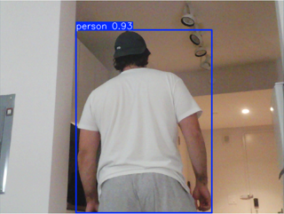 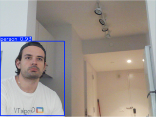 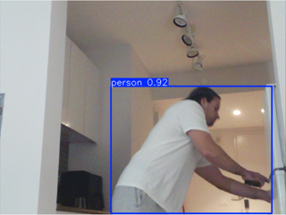

*Back turned (0.93), close to the camera (0.93), and at the far side of the room (0.92).*

What worked better than I expected: turning my back did not fool it at all (0.89–0.94 on every frame), and raising the bar to `--conf 0.7` did not lose me even at the far side of the room, where my box shrank from 479 px to 151 px tall.

**Failure modes**

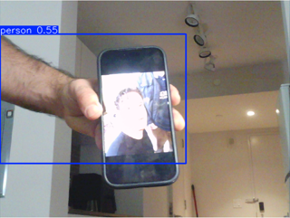 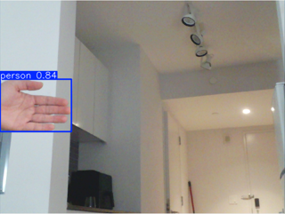 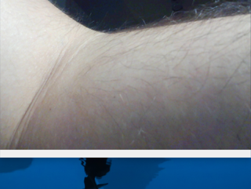

*Phone photo (person 0.55), a hand alone (person 0.84), and my arm covering the lens (nothing).*

1. **It saw a person who was not there: a photo on my phone.** With me out of frame and only my phone photo visible, it reported a person at 0.40–0.83, and often two or three "people" at once: the photo, plus my hand and arm as separate partial people. My guess at the cause: YOLO matches what a person looks like in a flat image. It has no sense of depth or liveness, so a picture of a person *is* a person to it.
2. **A hand alone became a whole person.** With `--conf 0.2`, my hand at the edge of the frame was detected as "person" at 0.84. The person class includes partial bodies, so this is "correct" for YOLO, but in Part E's interpreter the hand would become `1 person(s) at left/far`, because the box is small. A small box no longer means far away.
3. **It did not see me when I was too close.** While I was adjusting the camera during a setup run, my arm covered the lens and it reported 0 people, even though I was right there. My guess: at that range there is no recognizable body outline, just skin and blur.
4. **With `--all`, it misnamed my objects.** I held up a water glass and a milk bottle. The milk bottle was detected as "bottle" (0.41–0.93), but the water glass kept flipping between "cup" and "wine glass" (0.40–0.52) from frame to frame. My phone was never labeled "cell phone"; it showed up twice as "remote". There were also single-frame labels for "sink" and "laptop". My guess: the objects are small at the model's 320 px input size, and a clear glass has few features, so the label changes between similar classes.

## Part C. See more: hands and pose with MediaPipe

*Include a screenshot or short video of the hand pose demo, and write how you might use face, hand or body pose tracking in your observant system.*

I ran three 25-second trials of `hand_pose.py` on the Pi 5: the pinch volume control, the Quiet Coyote, and the same pinch close to the camera and then at arm's length. MediaPipe tracked my hand at about 15 frames per second. I had no speaker connected, so I followed the volume on the on-screen bar.

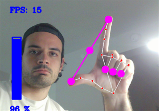 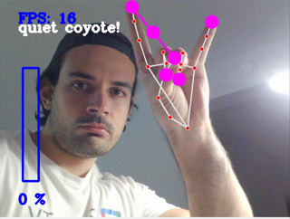

*An open pinch set the volume to 96%; the Quiet Coyote muted it.*

The pinch worked as designed: the bar followed my thumb and index finger through 96%, 58%, 50% and 0%. The Quiet Coyote was recognized whenever I made it, and I did not see it trigger on any other pose. Two things broke:

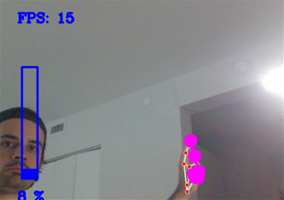 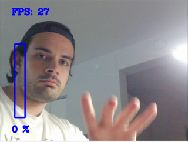

*At arm's length, a fully open pinch only reached 8%. A moving open hand was not detected at all.*

* **Distance changes the meaning of a gesture.** The rules are written in pixels: volume maps a 50–300 px thumb-to-index gap, and the Quiet Coyote checks for gaps over or under 100 px. At arm's length my whole hand is small, so a fully open pinch only reached about 60–135 px and the bar stayed at 0–8%. Close to the camera, with my hand partly over my face, the landmarks bunched up and read as a closed pinch. Measuring gaps relative to the size of the hand (for example, the wrist-to-knuckle length) would make the same gesture mean the same thing at any distance.
* **A moving hand can disappear.** When I opened my hand and moved it, MediaPipe found no hand at all, and the volume simply stayed where it was (muted). The system does nothing when it sees nothing, so a missed gesture is silent.

**How I would use it in my observant system:** the Quiet Coyote becomes the on/off switch for the night. At bedtime I make the gesture at the device, and it starts timing my sleep. In the morning I make the same gesture again, and it stops and reports how long I slept. A deliberate, unusual hand shape is a good trigger because I would not make it by accident. The camera only needs to see my hand at the device, not my bed. From these trials, I would require the gesture to be held for about a second before it counts, use hand-size-relative distances so it works wherever I stand, and give a clear acknowledgement (a tone or a dimming light) so I know it registered, because a missed gesture is otherwise invisible.

## Part D. Reason: run Qwen on the Pi with Ollama

*Ask Qwen three questions to answer. Paste the questions, the answers and how long each took. Try one of them with `qwen3:0.6b` and compare.*

I asked three questions whose answers I can check, through `ask_qwen.py` (thinking off, at most three sentences, 120 tokens), first with `qwen3.5:0.8b` and then all three again with `qwen3:0.6b`. The second question is the arithmetic my sleep timer from Part C would need. The third has a wrong premise on purpose: Cornell Tech opened on Roosevelt Island in 2017, not 2005.

| Question | Correct answer | `qwen3.5:0.8b` | `qwen3:0.6b` |
|---|---|---|---|
| Tell me a bit about the history of Roosevelt Island. | Blackwell's Island, then Welfare Island, renamed for FDR in 1973; Cornell Tech in 2017 | **Wrong** (17.7 s): a private residence of William Henry Harrison, named by Theodore Roosevelt for his grandfather | **Wrong** (13.8 s): "located in the Pacific Ocean", a 1922 Navy refuge |
| If I go to bed at 11:40 pm and wake up at 7:15 am, how long did I sleep? | 7 h 35 min | **Wrong** (10.0 s): 16 h 25 min | **Wrong** (0.9 s): 13 h 30 min |
| Why did Cornell Tech open its Roosevelt Island campus in 2005? | It opened in 2017 | **Accepted the wrong year** (6.1 s) and invented a reason (affordable education for lower-income areas) | **Accepted the wrong year** (2.6 s) and invented a reason |
| *Image:* `--image snap.jpg` "What is in this photo?" | Me, in a backwards black cap, seen from below | **Mostly right** (31.7 s): "A man wearing a black cap and looking down into the camera." | (text only) |

<details>
<summary>Full answers</summary>

**Roosevelt Island, qwen3.5:0.8b (17.7 s):** Roosevelt Island was originally built as a private residence for William Henry Harrison, who died there in 1840. The island's name was later adopted by President Theodore Roosevelt to honor his grandfather, and it became a major tourist destination in the early 20th century.

**Roosevelt Island, qwen3:0.6b (13.8 s):** Roosevelt Island, located in the Pacific Ocean, was established in 1922 as a temporary refuge for the U.S. Navy. It was initially a temporary naval base and later became a significant research site for the U.S. government and the National Oceanographic and Atmospheric Administration. Today, it remains a symbol of the U.S. commitment to environmental protection and international collaboration.

**Sleep time, qwen3.5:0.8b (10.0 s):** I calculate the time difference between your wake-up time (7:15 am) and your bedtime (11:40 pm). Subtracting these two times gives you a total duration of 16 hours and 25 minutes. This means you slept for approximately 16.4 hours.

**Sleep time, qwen3:0.6b (0.9 s):** You slept for 13 hours and 30 minutes.

**Cornell Tech 2005, qwen3.5:0.8b (6.1 s):** Cornell Tech opened the Roosevelt Island campus to provide students with a more affordable and accessible education for those living in lower-income areas of New York City.

**Cornell Tech 2005, qwen3:0.6b (2.6 s):** Cornell Tech opened its Roosevelt Island campus in 2005 to provide a more convenient and accessible educational experience for students and professionals, especially in the region. The campus is designed to support the growth of the university and its community.

**Photo, qwen3.5:0.8b (31.7 s):** A man wearing a black cap and looking down into the camera.
</details>

Out of six text answers, none was correct. Both models wrote confident, fluent sentences with invented facts, both got the sleep arithmetic wrong (and differently from each other), and both accepted the wrong year and made up a reason for it. The 0.6b model was faster (0.9–13.8 s vs 6.1–17.7 s; the first 0.8b answer includes loading the model), but not more accurate; it put Roosevelt Island in the Pacific Ocean. The image answer was the best one: it described what it actually saw, even though it took the longest (31.7 s).

What this means for my system: Qwen should never compute or recall anything that matters. My sleep timer will calculate the duration in Python from the two gesture timestamps and give Qwen the finished number, so its only job is to put the facts I give it into a friendly sentence. I will also check its morning report against the log, because it will invent events as readily as it invented Roosevelt Island's history.

## Part E. Connect: from YOLO readings to Qwen reasoning

`yolo_to_qwen.py` runs the whole pipeline: YOLO finds people, `interpret()` turns each frame into a reading in words ("1 person(s) at center/close": left, center or right by which third of the frame, close if the box is taller than 60% of the frame), a reading goes into the log only when it changes, and Qwen answers a question about the log.

I ran the pipeline for 60 seconds with a planned sequence: stay out of frame for 10 seconds, walk in and stand back on the camera's right, come close to the center at 25 seconds, and leave at 45 seconds. This is the log it wrote:

```
19:44:22 nobody
19:44:39 1 person(s) at left/close
19:45:15 nobody
```

Qwen (11.6 s): *"There was initially no one present. A single person appeared at 19:44:39 near the left side of the room, but they were gone by 19:45:15. No other activity or changes occurred during this observation period."*

Qwen summarized the log correctly. The log itself, though, lost most of what I did, and the interpreter explains why:

* **I stood on the camera's right, but it logged "left," because my webcam mirrors its image.** I checked with a second test: standing on the camera's right, my box was at the far left edge of the frame (its center at 3–9% of the width). `yolo_to_qwen.py` does not flip the frame back, so every "left" in my logs is the room's right, and the reverse. Flipping the frame with `cv2.flip(frame, 1)` before YOLO should fix it; I have not tested that yet.
* **I was never "far."** Even standing back, my box was taller than 60% of the frame. I probably wasn't far enough back, and 60% is a lot for a webcam in a small room.
* **Walking to the center left no trace.** I stayed "close" and probably never crossed out of the left third, so the reading never changed, and the log only writes a line when it changes.

Three lines out of a minute of movement: the model can only be as good as the words the interpreter gives it.

**An empty log.** In two earlier runs I was not in front of the camera, and the log was a single `nobody` line. Qwen got the count right both times but padded the answer with things that were not in the log, such as *"a line appeared on the detector's screen at 19:37:17, which indicates a change in state rather than an actual person."* The first of those answers took 88 s, because the model was loading after a reboot. The second took 10.8 s.

**Does it notice contradictions?** I edited the real log by hand to add three impossible lines and fed it back with `--log`:

```
19:44:22 nobody
19:44:39 1 person(s) at left/close
19:44:51 2 person(s) at right/far       <- two people, one position
19:45:02 nobody
19:45:02 1 person(s) at center/close    <- nobody and someone in the same second
19:44:30 1 person(s) at left/far        <- time goes backwards
19:45:15 nobody
```

| Question | Qwen's answer | What's wrong |
|---|---|---|
| The default question (9.6 s) | "There are currently 2 people present in the room. One person was located on the left side of the room, while another was on the right side. No other changes were made to the scene during this observation period." | The log ends with nobody. It merged lines from different times into two people at once, said nothing changed, and noticed none of the contradictions. |
| "Is anything in this log inconsistent or impossible? Point to the lines." (14.2 s) | It flagged that 19:45:02 appears twice, and said the `nobody` at 19:44:22 contradicts the lines "recorded immediately before it." | It found one of the three, and only as a "duplicate entry." The second claim is invented: 19:44:22 is the first line. It missed the backwards timestamp and the two people with one position. |

So the model does not check its input. Asked an open question, it trusts the log completely. Asked to look for problems, it finds some and invents others. For my overnight system, the checks go in code before the prompt: timestamps must move forward, the number of people must match the number of positions, and gaps in the log are reported as gaps. Qwen only gets a log that has already passed those checks.

---

# Part 2: Overnight Sensation

## Part F. Storyboard the night-time interaction

*Insert ideas, sketches, Verplank diagrams and storyboards for your night-time interaction here.*

**My idea: the Quiet Coyote Sleep Tracker**, a sleep tracker and sleep aid that I hand the night over to with one gesture.

* **During the day** the device is dormant and shows its state on the Pi screen.
* **Before bed** I make the Quiet Coyote at the camera. The screen changes and the device speaks to acknowledge that the night has been handed over.
* **While I sleep** it plays soft music to help me fall asleep and checks in a loop whether there are people in the camera's view, logging only the changes.
* **In the morning** it plays an alarm at a preset time. I turn it off with the same Quiet Coyote gesture. The device tells me how long I slept and what happened during the night, then returns to dormant.

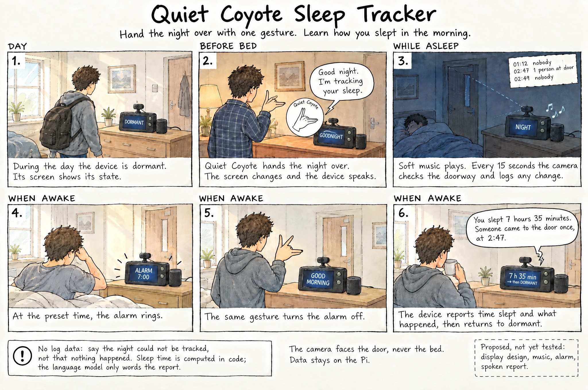

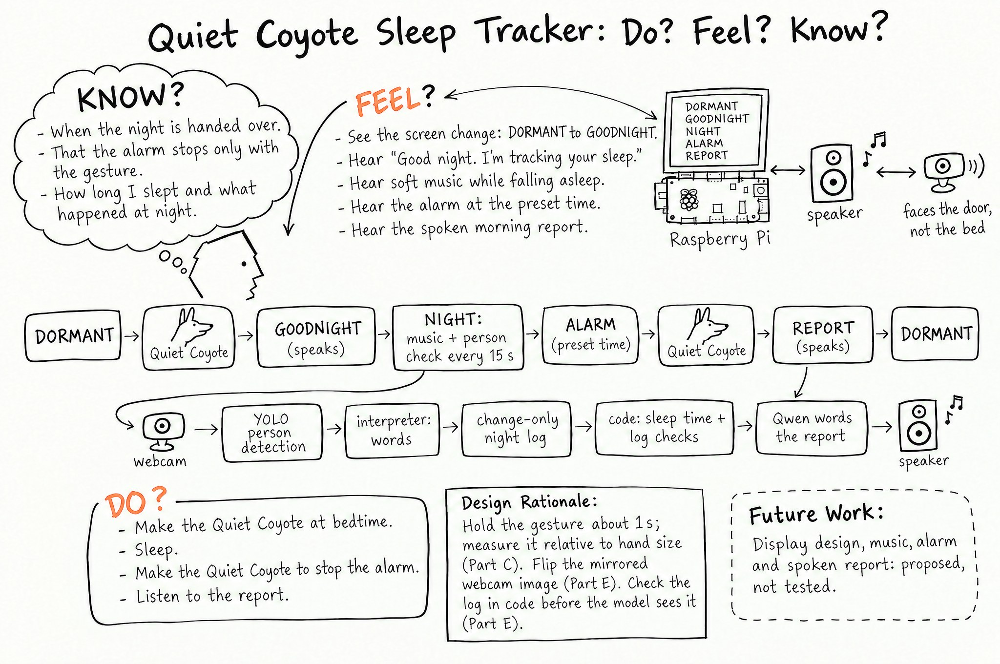

The gesture comes from Part C, where the Quiet Coyote never fired by accident. Part C also showed that a gesture measured in pixels changes meaning with distance, so I will require it to be held for about a second and measure it relative to the size of the hand. Part E shaped the rest. The camera faces the door, not the bed, and the image has to be flipped because my webcam mirrors it. The sleep time is computed in code from the two gestures, and the log is checked in code before Qwen sees it, because Qwen got simple arithmetic wrong in Part D and missed contradictions in Part E. Qwen only puts the facts into words. If the log is empty or missing, the report has to say the night could not be tracked, not that nothing happened. The spoken lines, the 7:00 alarm, the 15-second check interval and the sample report in the images are placeholders. None of this was built or tested yet at this stage.

## Prep for Part 2

*Put the feedback for your ideas here.*

**Feedback:** the feedback on my storyboard was that the screen felt flat. It only showed state words (DORMANT, GOODNIGHT, NIGHT, ALARM), which does not fit a device that sits next to the bed and is meant to calm me down. That is what made me change the display design. Instead of words, the screen now shows the sky:

* **Day:** the sky, sun and moon follow the real time, with the clock and the alarm time in small text.
* **Good night:** after the Quiet Coyote, the sun sets, the stars come out and "Good night" fades in.
* **Night:** the screen dims to a moonlit sky. The moon crosses the screen between bedtime and the alarm, so a glance shows how much of the night is left.
* **Alarm:** the screen brightens into a sunrise and shows the alarm time.
* **Morning:** a morning sky with how long I slept and a timeline of the night with one tick per event. With no data, it says the night was not tracked.

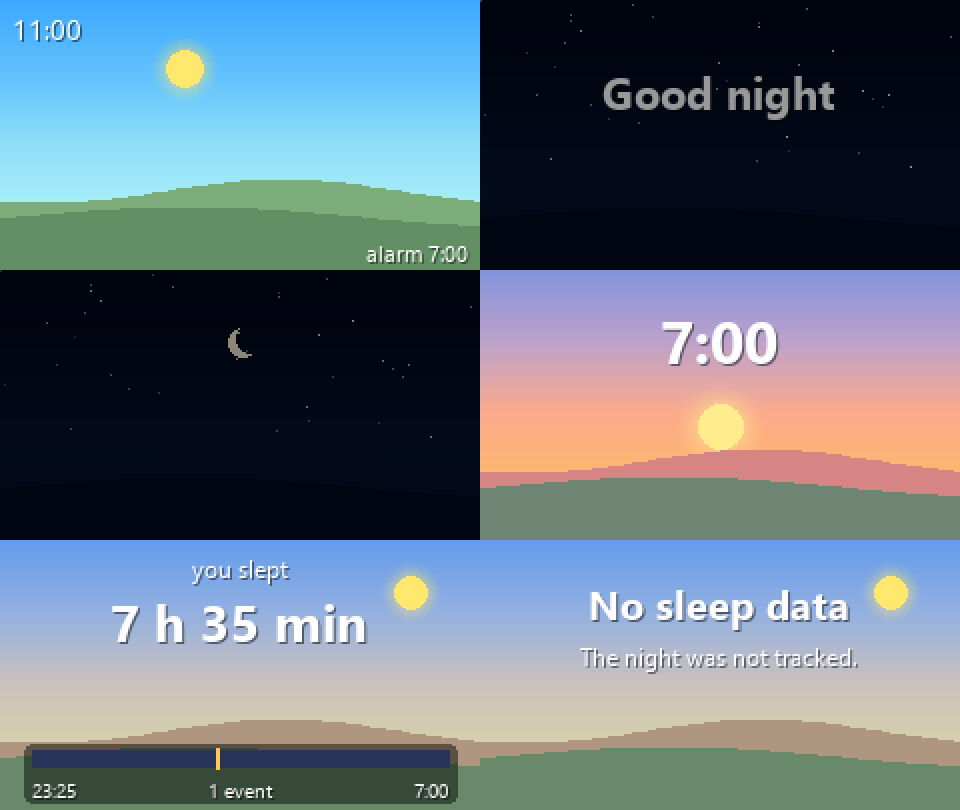

*Frames from my display code, enlarged 2×: day, good night, night, alarm, the morning report, and the report for a night with no data.*

I ran all the screens on the Mini PiTFT. The animations were smooth (17–18 frames per second), the text was readable at arm's length, and the night screen was dim enough for a dark bedroom.

**Lab Hub:** my repository already contained the latest course content for Part 2.

**Where the device spends the night:** on the dresser in my bedroom, with the camera facing the door, not the bed. I live alone, so there is no one else to ask. The night log stays on the Pi.

*Post your revised storyboard here.*

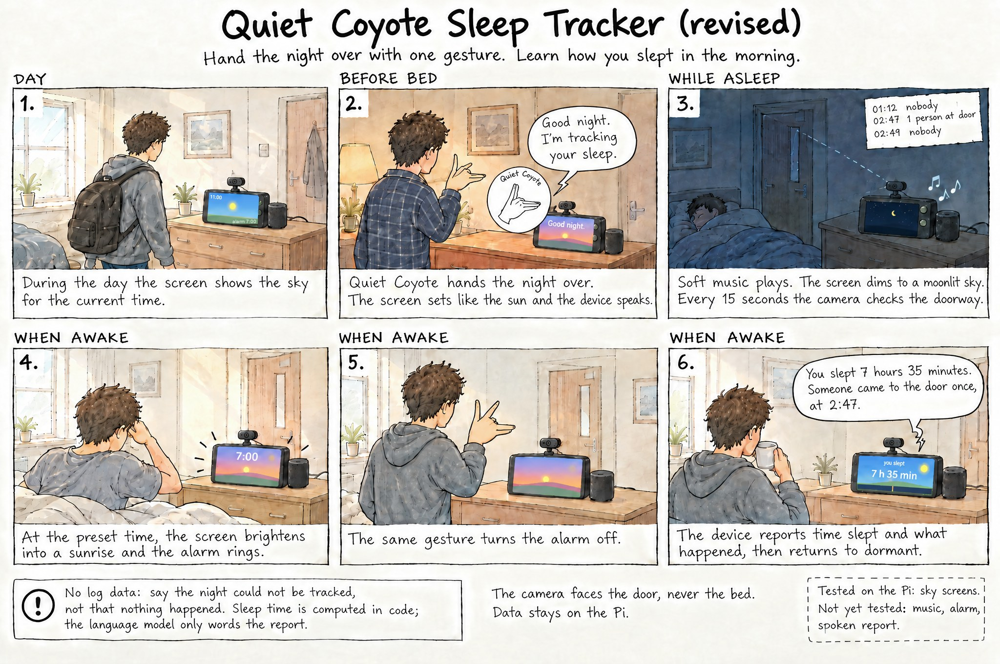

The interaction is the same. The changes are the screens: each panel now shows the sky scene for that moment instead of a state word. What I learned in Part E was already in the first version: the camera faces the door, the webcam image has to be flipped, the sleep time is computed in code and the log is checked before Qwen sees it, and an empty log is reported as an untracked night. The box at the bottom right now separates what I have tested on the Pi (the screens) from what I have not (music, alarm, spoken report).

## Part G. The interaction before bed

*Describe the interaction before.*

**The hand-off is the Quiet Coyote.** When I am ready for bed, I stand in front of the device and make the Quiet Coyote at the camera. I chose it because in Part C it never fired on any other pose, so I cannot hand the night over by accident. I hold it for about a second, and the device measures it relative to the size of my hand, so it works whether I stand close or a step back.

**Then I set the alarm by voice.** As soon as the gesture is recognized, the device asks: "Good night. What time should I wake you?" I answer with a time, for example "seven fifteen", and it reads it back with the part of the day: "Alarm set for 7 15 in the morning. Say no to change it." If I stay quiet, it says "Okay. I'm tracking your sleep." If it misheard me, I say "no" and it asks again, or I say "no, seven oh five" and it takes the new time. If it does not understand me at all, it asks again, and after three tries it keeps the last alarm time and says which one, so I never go to bed without knowing when it will ring.

**The acknowledgement is light going down and a voice.** While we talk, the screen sets like the sun: the day sky turns to sunset, the stars come out and "Good night" fades in, with the alarm time in small text. Once the alarm is confirmed, the screen dims to its night level and the soft music starts.

**The question it sets for the morning:** how long did I sleep, and did anything happen at the door? Bedtime is recorded when the gesture is recognized, and the camera starts checking the doorway every 15 seconds.

**The whole ritual takes under thirty seconds:** walk to the dresser, make the gesture, say the wake-up time, hear it confirmed, go to bed. If the gesture is not recognized, nothing changes: the screen stays on the day sky, so I can see it did not register and try again.

All of this is built (`sleep_tracker.py`) and worked in my rehearsals: the one-second hold, the spoken question and read-back, the sunset screen, the lullaby and the bedtime entry in the log. Saying "no" to correct the time has only been tested with scripted answers so far.

## Part H. The observant system during the night

*Screenshots or videos of the running system.*

**Videos of my rehearsals:** [Lab 5 videos folder](https://cornellprod-my.sharepoint.com/:f:/r/personal/pp555_cornell_edu/Documents/INFO%205345%20Lab%20Videos/Lab%205?d=wfa7fb1c27d5540feb8849c7db1ea7464&csf=1&web=1&e=3Qy59r)

**Fake night with the starter code.** I ran the original `overnight.py` in tmux for 30 seconds while I walked in and out of view twice, then the original `morning.py`:

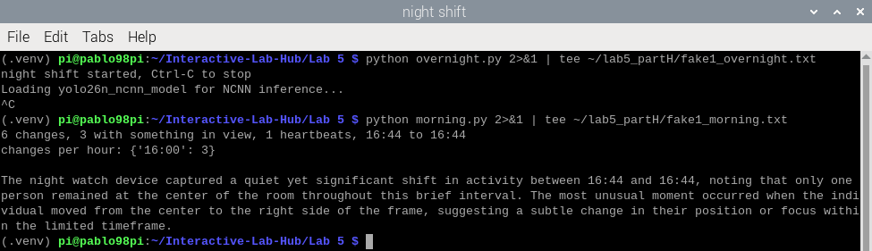

The log was right: nobody, then me at center/far and center/close, nobody, me again, nobody. Qwen's report was not. It said that "only one person remained at the center of the room throughout" an interval "between 16:44 and 16:44", although I left in between, so there were two separate visits. This is the Part D and Part E lesson again, and it shaped Part I: the morning facts must come from code, not from the model.

**My night shift.** I rewrote `overnight.py` for my design:

* **Flip the frame** before YOLO, because my webcam mirrors its image (Part E).
* **One look every 15 seconds**, plus a **motion trigger**: every half second it compares a tiny blurred copy of the frame, and if more than 2% of it changes, it looks right away. In my first rehearsal I walked past the camera and the log only said "nobody", because a few seconds of walking fell between two looks. With the trigger, the next rehearsal logged me at a time between the 15-second looks.
* **No snapshots.** Only the reading in words goes into the log, with a "bedtime" and a "wake" entry, and an "alive" line every 10 minutes so a quiet night can be told apart from a crashed one.

**The whole interaction.** `sleep_tracker.py` runs the night from start to finish in tmux: it waits for the Quiet Coyote, asks for the wake-up time (Part G), plays the lullaby, runs the night shift until the alarm, wakes me with the sunrise screen and song, waits for the Quiet Coyote again and gives the morning report (Part I). The other files are `coyote.py` (the gesture), `voice.py` (Piper and Whisper from Lab 3), `audio.py` (music and alarm with fades), `sky_display.py` (the screens) and `morning.py` (the report).

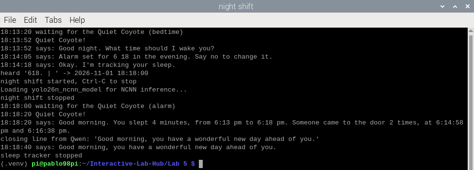

*Rehearsal 4: a five-minute night with every part working.*

I rehearsed the whole night four times with the alarm a few minutes away. Each rehearsal broke something I would not have found by reading the code:

| Rehearsal | What broke | What I changed |
|---|---|---|
| 1 | My walk past the door was not logged. Qwen's report said "four minutes of sleep" (right) and that I "made it through your day without needing to leave the room" (invented). | Motion trigger. The facts are now always a template filled in by code. |
| 2 | Whisper heard "Mmm, 546." without the "pm", and the device said "Alarm set for 5 46", so I could not hear the mistake. Ctrl-C did not stop the whole program. | The read-back always says the part of the day ("in the evening"). Ctrl-C stops everything. |
| 3 | I said "six o 2" and it set 6:00. I also could not see what the camera saw. The speech stuttered while Qwen was busy. | "Say no to change it" after the read-back, 5 seconds to answer instead of 4, a `--preview` camera window for rehearsals, and speech made before it is played. |
| 4 | Everything worked; "Good morning" was said twice. | Qwen's line no longer starts with "Good morning". |

To check that rehearsal 3 was not a recognition problem, I let the Pi ask me to say four times and transcribed my recordings with two Whisper models: both got all four right ("602.", "715", "630.", "No, 705."). The miss was timing, so the fix was the read-back and the longer window, not a bigger model.

## Part I. The interaction when awake

*Make it yours, and make sure it is honest about a night in which nothing happened.*

**The reveal is a sunrise, a song and two sentences.**

1. **Ten minutes before the alarm,** the dim moonlit screen slowly turns into a sunrise and gets brighter.
2. **At the alarm time,** the sunrise song plays. It starts almost silent and grows over a minute, and it repeats until I make the Quiet Coyote. If I don't, it stops after 20 minutes.
3. **The Quiet Coyote turns it off,** and the device says "Good morning" and two facts: how long I slept and what happened at the door, for example: *"You slept 7 hours 35 minutes, from 11:25 pm to 7:00 am. Someone came to the door once, at 2:47 am."*
4. **The screen shows the same report:** the sleep time in large text over a morning sky, and a timeline of the night with a tick for each visit.
5. **Qwen adds one warm closing line,** for example *"You have a wonderful new day ahead of you."* Then the device goes back to the day sky.

**The facts never come from the model.** Time slept is the wake-up gesture minus the bedtime gesture. A visit is a run of readings that are not "nobody". Qwen is only asked for a closing sentence, it is told nothing about the night, and the sentence is thrown away if it contains a number, a time or anything about the door or visitors. I made this choice after Qwen got the sleep arithmetic wrong in Part D, missed contradictions in Part E, and invented events in my fake night and my first rehearsal.

**Honest about an empty night.** The report says what the log can and cannot support:

| The log shows | The device says |
|---|---|
| A watched night with no visits | "Nobody came to the door." |
| No log at all | "The night was not tracked. I have no log, so I cannot say how you slept or what happened." |
| More than 15 minutes with no line at all (not even the "alive" line) | "I was not watching from 3:00 am to 4:00 am, so I may have missed something." |
| Times going backwards or unreadable lines | "Part of the log was out of order or unreadable, so take this with a grain of salt." |

I checked these four cases with hand-made logs, in the same spirit as the edited log in Part E.

**Checking the design against Bellotti et al.'s five questions:**

| Question | My answer |
|---|---|
| **Address:** how do I talk to it, and how do I avoid talking to it by accident? | The Quiet Coyote, held for a second. I calibrated it on my hand: other hand shapes never lasted long enough to count (the longest was 0.1 s). |
| **Attention:** how do I know it is listening? | The screen starts setting like the sun the moment the gesture is recognized, and it asks me a question out loud. |
| **Action:** how do I tell it what to do? | One gesture means "the night starts" or "I am awake", and the only thing I say is a time. |
| **Alignment:** how do I know it understood? | It reads the alarm time back with the part of the day, and in the morning the screen and the voice give the same report. |
| **Accident:** how do I recover from a mistake? | "No" to a wrong time; three failed tries keep the last alarm and say which one; the alarm gives up after 20 minutes; the report says when it was not watching. What it cannot do yet is undo a hand-off made by mistake. |

## Final documentation

*Include a short video of the whole system.*

**Video of the whole system:** [Lab 5 videos folder](https://cornellprod-my.sharepoint.com/:f:/r/personal/pp555_cornell_edu/Documents/INFO%205345%20Lab%20Videos/Lab%205?d=wfa7fb1c27d5540feb8849c7db1ea7464&csf=1&web=1&e=3Qy59r)

Houde and Hill's *What do Prototypes Prototype?* separates three questions: the **role** the device plays in someone's life, its **look and feel**, and its **implementation**. My prototypes answer them separately, and the rehearsals put them together.

### Looks like (look and feel)

The working prototype is a Pi on a desk with cables, so to show how it would sit in a bedroom I designed an enclosure and made two concept renders of it.

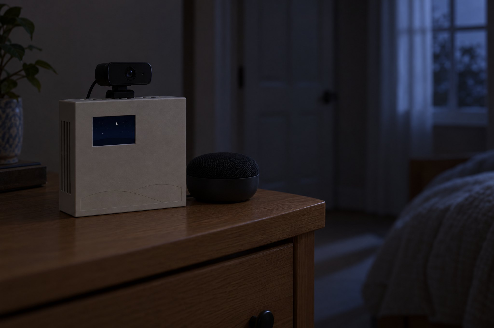 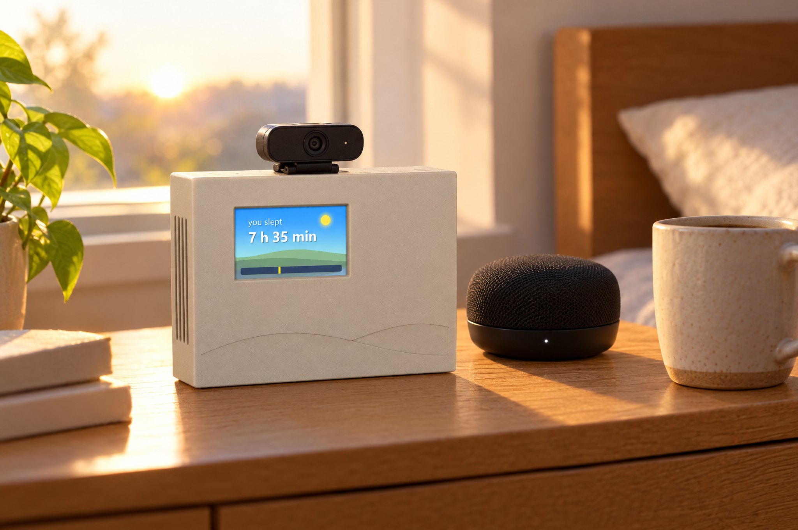

*Concept renders made from my CAD model and my real screen designs, not photos: at bedtime the screen is a dim moonlit sky and the webcam faces the door; in the morning it shows the report.*

The enclosure is a small off-white box (96 × 84 × 32 mm) for the Pi 5. The board stands upright so the Mini PiTFT looks out through a window in the front, two hills like the ones on the screen are recessed into the front face, the USB ports face a cut-out on the right for the webcam, microphone and speaker, and the webcam clips on the flat top. It is two printed parts: a shell, printed front face down, and a back plate with the standoffs for the Pi. The power cable leaves through a notch in the back plate.

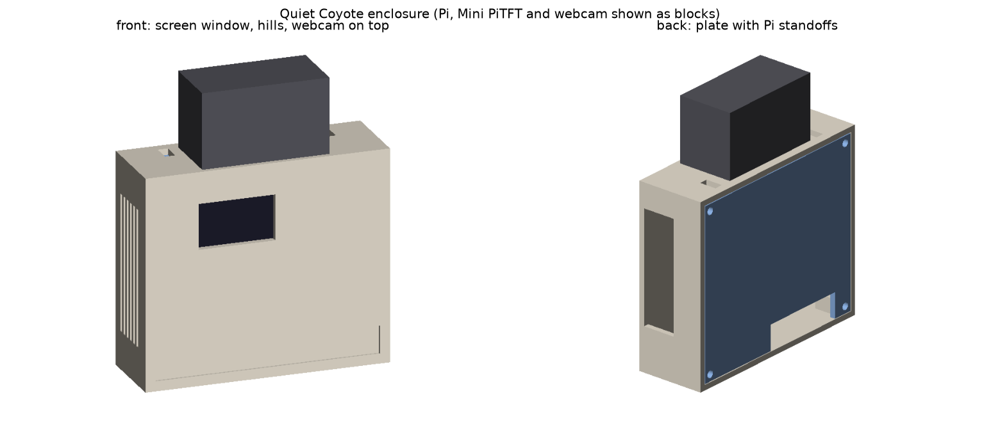

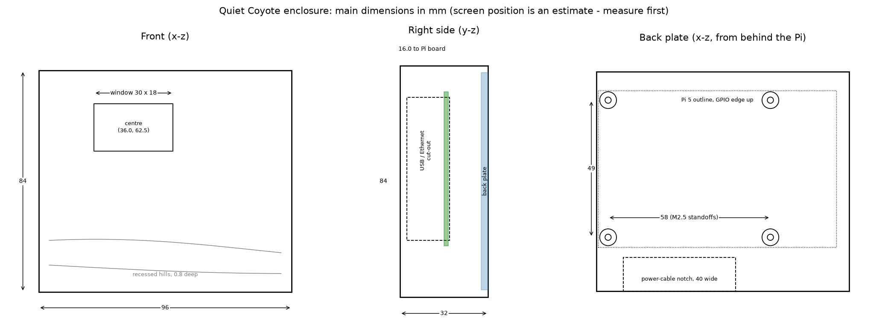

CAD files: [`cad/enclosure.py`](cad/enclosure.py) (parametric source), [`cad/shell.stl`](cad/shell.stl), [`cad/back_plate.stl`](cad/back_plate.stl). The Pi's hole positions come from the Raspberry Pi 5 drawing; the position of the Mini PiTFT's screen is an estimate that I need to measure before printing it at the MakerLAB.

### Works like (implementation)

The pipeline from Part E, running all night on the Pi:

**camera** (flipped) → **YOLO** person detection every 15 s, or sooner when something moves → **interpreter** (`interpret()` from Part E: "1 person(s) at left/close") → **night log** (`night_log.jsonl`, only changes, plus bedtime, wake and "alive" lines) → **code** computes sleep time, visits and gaps → **Qwen** writes only a closing line → **Piper** speaks the report, and the **Mini PiTFT** shows it.

**My first real night (November 1 to 2).** I started `sleep_tracker.py` in tmux at 10:22 pm. This is what it printed:

```
22:22:45 Quiet Coyote!
22:22:45 says: Good night. What time should I wake you?
22:23:04 says: Alarm set for 8 30 in the morning. Say no to change it.
22:23:15 says: Okay. I'm tracking your sleep.
08:30:00 waiting for the Quiet Coyote (alarm)
08:30:32 Quiet Coyote!
08:30:32 says: Good morning. You slept 10 hours 8 minutes, from 10:22 pm to 8:30 am. Someone came to the door once, at 10:25 pm.
08:30:46 says: You have the power to wake your spirit, and I hope for a bright, fresh start to every new day together.
```

The [night log](night_log.jsonl) has 66 lines: bedtime, the alarm, one visit, an "alive" line every 10 minutes and the wake-up. The first lines:

```
{"t": "2026-11-01T22:22:45", "event": "bedtime"}
{"t": "2026-11-01T22:23:20", "event": "alarm_set", "alarm": "08:30"}
{"t": "2026-11-01T22:23:23", "reading": "nobody"}
{"t": "2026-11-01T22:23:23", "alive": true, "temp": 57.85}
{"t": "2026-11-01T22:25:56", "reading": "1 person(s) at left/far"}
{"t": "2026-11-01T22:26:02", "reading": "nobody"}
{"t": "2026-11-01T22:33:33", "alive": true, "temp": 44.1}
```

What worked: the gesture and the time were understood the first time, the lullaby played at a volume that was just right for falling asleep (I had turned it down to 12% before bed), the alarm went off at 8:30, and the report is exactly what the log supports. There are no gaps: the longest stretch between two lines is the 10 minutes between "alive" lines, so the camera was watching all night. The Pi has no fan, so I logged its temperature: it stayed between 39 °C and 58 °C, far from the 75 °C at which my code slows down and the 85 °C at which the Pi throttles itself.

What it shows about the design: "10 hours 8 minutes" is time in bed, from the bedtime gesture to the wake-up gesture, not time asleep. The camera cannot tell when I fell asleep. The one visit, three minutes after the hand-off, was me still moving around the room, so the first minutes after bedtime should not count as visitors. And Qwen's closing line passed my filter but is a strange sentence for 8:30 am, which supports keeping the model out of the facts.

### Acts like (role)

The person hands the night over with one gesture and a time, and gets back two facts and a sunrise. The storyboard in Prep for Part 2 shows the whole night; Parts G and I describe the hand-off and the reveal, and the rehearsals in Part H show that it works end to end. The device never needs a phone, an app or a button: the Quiet Coyote starts and ends the night, and the only thing I say is when to wake up.

### Testing with users

I had other people try the hand-off. Setting the time frustrated them: when the device misheard the time, they had no way to tell and no way to fix it. That is why I redesigned that step. The device now reads the time back with the part of the day ("Alarm set for 7 15 in the morning"), gives them 5 seconds instead of 4 to answer, and lets them say "no" to try again or "no, seven oh five" to correct it in one go.

## Files

* Code: [`sleep_tracker.py`](sleep_tracker.py) (the whole interaction), [`overnight.py`](overnight.py) (night shift), [`morning.py`](morning.py) (report), [`coyote.py`](coyote.py) (gesture), [`voice.py`](voice.py) (speech in and out), [`audio.py`](audio.py) (lullaby and alarm), [`sky_display.py`](sky_display.py) (screens), and the starter [`yolo_to_qwen.py`](yolo_to_qwen.py) for `interpret()`.
* Enclosure: [`cad/`](cad/) (parametric source, STL files, renders and drawing).
* Night log: [`night_log.jsonl`](night_log.jsonl) (my first real night, November 1 to 2).
